# 智慧表格 — 功能介绍与设计文档

> 状态：V1+V2 已实现（2026-10-14） ｜ 2026-10-13 初稿
> 实现对应：后端 `routers/smart_*.py` + `services/field_registry.py/view_config.py/lookup_service.py`；前端 `views/smart/` + `components/smart/` + `smart/registry/`；测试 `backend/smoke_smart*.py`、`frontend/tests/smart.test.js`、`frontend/e2e/smart-*.spec.mjs`。
> 参考：`docs/智慧表格/**/*.png`（企业微信「智能表格」功能截图，共 102 张，逐张分析）
> 目标：在本项目（Vue3 + FastAPI + 元数据驱动 dyn_engine）之上，实现对标企业微信智能表格的「智慧表格」子系统。
> 注意：部分截图文件名与画面内容错位（已在附录 A 标注对照表），本文档一律以**实际画面内容**为准。各章节已内嵌对应参考截图（相对路径 `智慧表格/` 下的 PNG）。

---

## 目录

1. [产品定位与总体认识](#1-产品定位与总体认识)
2. [信息架构与整体布局](#2-信息架构与整体布局)
3. [字段类型系统（22+1 种）](#3-字段类型系统)
4. [单元格编辑器体系](#4-单元格编辑器体系)
5. [视图系统：筛选 / 分组 / 排序 / 行高 / 填色](#5-视图系统)
6. [列操作与表头工具栏（含列编组/多级表头）](#6-列操作与表头工具栏)
7. [记录操作：右键菜单 / 详情 / 子记录 / 查找替换](#7-记录操作)
8. [关联与查询引用（跨表）](#8-关联与查询引用)
9. [公式引擎](#9-公式引擎)
10. [AI 字段](#10-ai-字段)
11. [自动化提醒引擎](#11-自动化提醒引擎)
12. [表单生成与数据回流](#12-表单生成与数据回流)
13. [权限体系（内容权限）](#13-权限体系)
14. [数据模型设计（DDL 级）](#14-数据模型设计)
15. [前端架构设计](#15-前端架构设计)
16. [后端架构与 API 设计](#16-后端架构与-api-设计)
17. [与现有系统的融合与改造点](#17-与现有系统的融合与改造点)
18. [分期实施计划](#18-分期实施计划)
19. [附录](#19-附录)

---

## 1. 产品定位与总体认识

### 1.1 定位

「智慧表格」是一个 **表格即数据库（Table-as-Database）** 的可视化数据管理子系统，对标企业微信智能表格 / 飞书多维表格 / Airtable：

- 对普通用户：长得像 Excel，上手零成本；
- 对系统：每一列是强类型字段，每一行是一条记录，表与表之间可关联，行可挂层级；
- 在此之上叠加：**多视图、筛选/分组/排序、条件填色、公式、跨表引用、AI 生成列、自动化提醒、表单收集、行列级权限**。

### 1.2 与现有项目的关系

本项目的核心理念本来就是「**元数据驱动**」（MetaTable/MetaField + dyn_engine 动态 SQL）。智慧表格不是另起炉灶，而是把现有能力**升级为一套完整的字段类型系统 + 视图引擎 + 协作权限**：

| 现有能力 | 智慧表格中的演进 |
|---|---|
| MetaField（text/number/date/select 等基础类型） | 扩展为 22+1 种字段类型，config JSON 承载全部配置 |
| dyn_engine（元数据 → SQL） | 保持不变，仍是唯一取数入口；新增筛选 DSL 编译、分组聚合、公式求值挂接点 |
| 任务引擎（APScheduler 定时规则） | 升级为「自动化引擎」：定时/事件双触发 + 多步动作链 |
| 报表/仪表盘 | 成为「数据可视化」入口的目的地（图表/看板由表格列一键生成） |
| tenant/RBAC 权限 | 叠加「内容权限」层：表级等级 + 行级条件 + 列级三态 |
| AI 助手/LLMGateway | 支撑 AI 字段、AI 生成公式、AI 匹配选项标签 |

### 1.3 核心设计原则（从截图归纳的产品规律）

1. **视图即配置**：筛选/分组/排序/行高/填色/列显隐/冻结全部挂在「视图」对象上，与数据彻底解耦，支撑同一数据的多 Tab 视图。
2. **存储与显示分离**：千位符、小数位、日期格式、币种、进度颜色均为渲染层配置，存储保持原始标量。
3. **存 ID 不存展示值**：选项存 optionId、人员存 userId、附件存 fileId、关联存 recordId——改名/改色/离职后数据不失联。
4. **徽章外显状态**：工具栏按钮上的数字徽标统一表示「该功能当前生效的规则条数」（筛选 1 / 排序 3 / 填色 1）。
5. **RuleBuilder 统一模式**：筛选/排序/分组/填色的配置面板共用同一套「拖拽手柄 + 字段选择 + 运算符 + 值 + 删除」的规则行组件。
6. **字段类型驱动一切**：每个字段类型注册自己的图标、编辑器、渲染器、可用运算符、排序文案、是否可分组——新增类型只需注册一次。

---

## 2. 信息架构与整体布局

### 2.1 五层信息架构（依据：总览/左侧菜单/上方Tab页签截图）

```
┌────────────────────────────────────────────────────────────────┐
│ L1 文档导航层（左侧菜单）                                        │
│   文档标题 + [提醒查阅] + 搜索                                   │
│   条目树：工作表 / 仪表盘 / 收集表单 / 分析报告(AI+) / 文件夹      │
│   新建：工作表｜仪表盘｜收集表单｜分析报告｜文件夹｜导入表格｜        │
│        同步数据｜从模板新建                                       │
├────────────────────────────────────────────────────────────────┤
│ L2 视图层（上方 Tab 页签）                                       │
│   [表格视图] [表格视图 2] [表单] [+]                             │
│   —— 同一数据的多视图，配置各自独立，数据共享                      │
├────────────────────────────────────────────────────────────────┤
│ L3 视图工具层（工具栏）                                          │
│   [+ 添加一行] [表格设置] [筛选 1] [分组] [排序 3] [行高] [填色 1] │
│   右侧：筛选条件胶囊区 | 表单 | 自动化 | 撤销 | 重做 | 查找        │
├────────────────────────────────────────────────────────────────┤
│ L4 数据网格层                                                    │
│   表格标题横幅（黄色，常驻跨列：表名（共 N 条）+ 说明文字）         │
│   列头（类型图标 + 字段名 + 筛选态漏斗 + 下拉菜单）                │
│   数据行（行号、复选框、树形折叠三角、按类型渲染的单元格）          │
│   底部汇总行（+ 添加 ｜ 记录数 55 ｜ 求和 2196251 …）             │
├────────────────────────────────────────────────────────────────┤
│ L5 协作辅助层                                                    │
│   右上：状态下拉、功能图标按钮（AI/自动化）、撤销/重做、搜索       │
│   （注意：截图中无协作头像区，功能入口均为图标按钮而非文字按钮）    │
│   右下：使用向导悬浮按钮                                          │
└────────────────────────────────────────────────────────────────┘
```

**参考截图：**

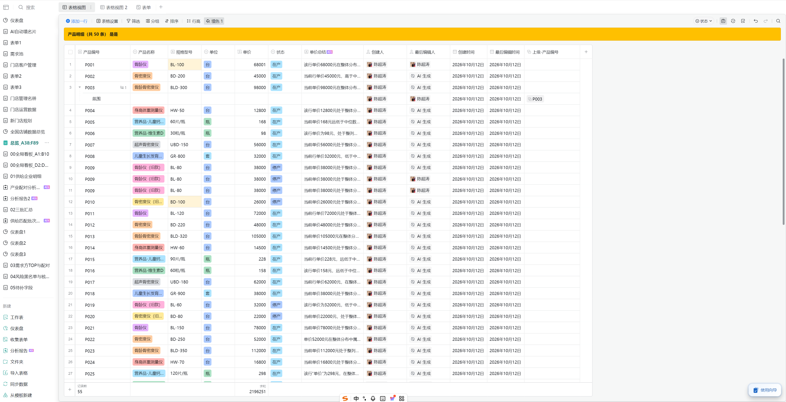


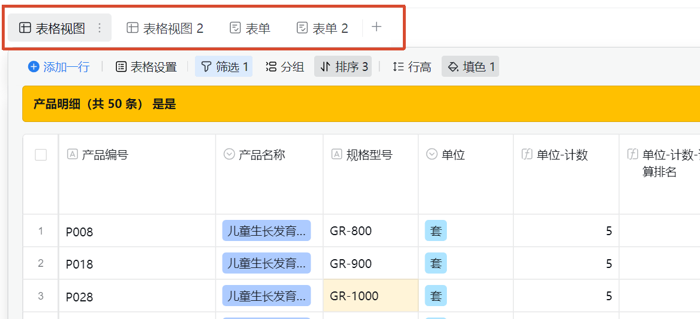


### 2.2 文档与条目模型

一个「智慧表格文档」是容器，内部条目为树形（文件夹可嵌套）：

```ts
interface DocEntry {
  id: string;
  docId: string;
  parentId: string | null;        // 文件夹
  type: 'sheet' | 'dashboard' | 'form' | 'report' | 'folder';
  name: string;
  order: number;
  aiFlag?: boolean;               // 「AI+」角标（AI 生成/绑定的条目）
}
```

- 条目 `...` 菜单：重命名 / 移入文件夹（二级级联选择目标文件夹，排除自身及子孙防环）/ 删除；文件夹为空时显示「文件夹为空」空态文案；文件夹行内 hover 显示 `+`（新建子条目）与 `⋯` 按钮。
- **统一节点树模型**：所有产物（folder/sheet/dashboard/form/report）都是目录树中的 Node，共用重命名/移动/删除菜单，权限、排序、回收站统一实现。
- 命名中的 `_A38:F89` 后缀说明支持**从单元格区域生成条目**（类 Excel 区域引用，一期可不做）。
- 「提醒查阅」：调用通知服务，向指定成员发送文档查阅消息。

### 2.3 视图 Tab

```ts
interface View {
  id: string;
  tableId: string;
  name: string;
  type: 'grid' | 'form' | 'kanban' | 'gallery';   // 一期实现 grid/form
  // —— 以下为视图级配置，全部视图间独立 ——
  filter: FilterConfig;
  groups: GroupLevel[];
  sorts: SortRule[];
  fillRules: FillRule[];
  rowHeight: RowHeightConfig;
  fieldVisibility: Record<fieldId, boolean>;
  fieldOrder: string[];
  frozenFieldId: string | null;    // 冻结至此列
  aggregations: Record<fieldId, AggType>;   // 底部汇总行配置
}
```

- 选中页签的 `⋮` 菜单：重命名 / 复制视图 / 删除 / 设为默认。
- 切换页签 = 替换 Grid 的配置 props，无需重新拉取数据（数据层与视图层分离）。
- 工具栏徽章数字 = 该视图自己的规则数。

### 2.4 表格设置面板（字段管理器）

点击工具栏「表格设置」展开侧滑面板，本质是**字段元数据数组的可视化编辑器**：

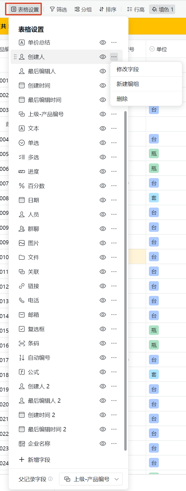

- 字段列表行：类型图标 + 字段名 + 👁（显隐，立即反映到网格）+ `...`（修改字段 / 新建编组 / 删除）+ 拖拽手柄（调整列顺序）；
- 末尾 `+ 新增字段`；
- 底部固定区：**父记录字段**下拉——指定一个「关联（自关联本表）」字段作为树形层级的父引用，选定后网格渲染父子树（折叠三角 + 缩进子行）。

**删除字段的级联检查**（必须做）：扫描引用该字段的公式、查询引用、填色规则、排序规则、筛选条件、自动化条件、权限配置，弹窗列出影响项，二次确认后才允许删除。

### 2.5 新建入口体系（左下角「新建」分组）

依据：`左下的新建/` 8 张截图（2026-10-13 补充）。八个入口分三种创建模式：

| 入口 | 产物节点 | 创建模式 | 创建后落点 |
|---|---|---|---|
| 工作表 | sheet | 即时创建（无弹窗） | 空白表格视图：自带默认 5 字段（文本/单选/人员/数字/日期）+ 5 行空记录，工具栏/视图 Tab/汇总行齐备 |
| 仪表盘 | dashboard | 即时创建 | 空状态引导页（「用仪表盘实时展示业务趋势」+ 三张示例卡片 +「添加图表」按钮）→ 图表配置弹窗（见下） |
| 收集表单 | form + 隐藏结果表 | 即时创建 | 表单编辑器：Tab「收集表单｜表单收集结果」；默认 3 题（文本题/单选题[选项1-3]/图片题）；左栏「可添加字段」；「编辑表单｜填写表单」切换 |
| 分析报告（AI✨） | report | 向导页 | 见「AI 分析报告」 |
| 文件夹 | folder | 即时创建（行内命名） | 目录树节点 |
| 导入表格 ▸ | sheet | 异步任务 | 子菜单三来源：**导入本地 Excel 文件 / 导入表格（在线表格）/ 导入聊天中的文件** |
| 同步数据 | sheet（绑定外部源） | 配置型 | 外部数据源定时同步（截图未展开，二期） |
| 从模板新建 | 整套文档树 | 模板库弹窗 | 模板实例化 |

**参考截图：**

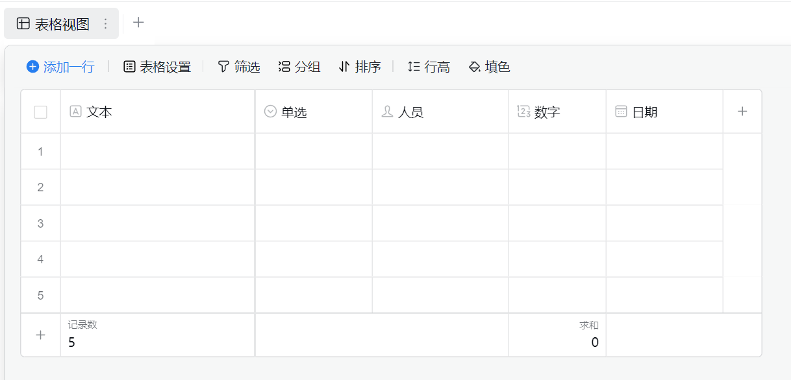


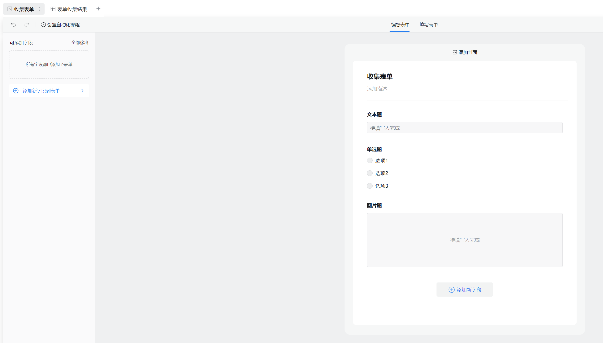

#### 2.5.1 仪表盘：图表配置弹窗

左配置右预览。配置区（「基础配置 / 更多配置」双 Tab）：

- **图表类型九宫格**：柱状图、折线图、饼图、条形图、组合图、表格、词云、指标卡、文本；
- **子类型**（随类型变化）：如柱状图 → 柱状图/堆积柱状图/百分比堆积柱状图；
- **主题色**：6 色色板 + 下拉；
- **数据源**：表选择器 + 右侧「筛选」按钮（对数据源做行级过滤）；
- **横轴（类别）**：类别字段下拉 + ☑「多选项拆分统计」（多值字段按各值分别计组）+ 排序依据（横轴值/指标 × 升降序）+ 二级类别字段（堆积/分组维度）；
- **纵轴（值）**：默认「记录行数」，可换字段 + 聚合方式；
- 右侧实时预览（图例 + 坐标轴 + 数据标签）；底部「取消 / 添加」。

实现要点：**通用聚合查询接口**（groupBy + count/sum/avg/max/min + 多值拆分 + 筛选下推），前端图表库建议 ECharts；widget 持 `sourceTableId` 引用，不复制数据。本项目直接复用现有报表引擎的取数层。

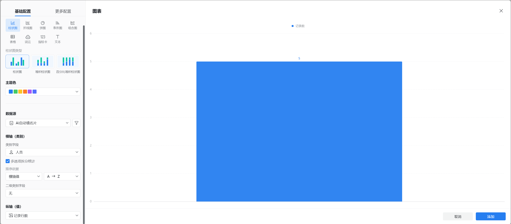

#### 2.5.2 AI 分析报告

向导首页：「快速生成 / 自定义生成」双按钮 + 基于现有表的推荐胶囊（✦ 分析「XX」）+「报告灵感」模板画廊（风格主题：默认/深色/画报；场景模板：项目管理/年度销售/订单回款等）。

生成管线（后端 LLM 编排）：数据画像（schema + 统计摘要）→ 规划分析维度/图表类型 → 复用聚合接口取数 → 洞察文案生成 → 组装报告（图表 block + 文字 block），异步任务 + 流式进度，产物可继续人工编辑。

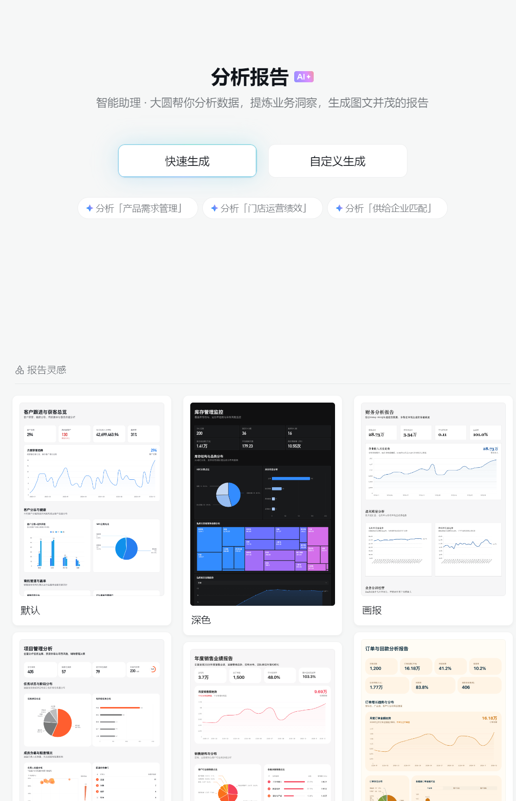

#### 2.5.3 模板库

全屏弹窗：搜索 + 「找人帮我搭」运营入口 + 快捷卡（导入 Excel / 我的模板）+ 分类分区（AI 提效 / 连接应用数据 / 产品研发流程 / 微信客户管理 / 办公必备…，每区 3 列卡片 + 展开更多）。卡片 = 名称 + 一句话描述 + 内嵌预览。实例化 = **深拷贝模板快照**（字段 + 视图 + 仪表盘 + 自动化规则）为新文档树，与模板后续更新解耦；「我的模板」支持把已有文档另存为模板。

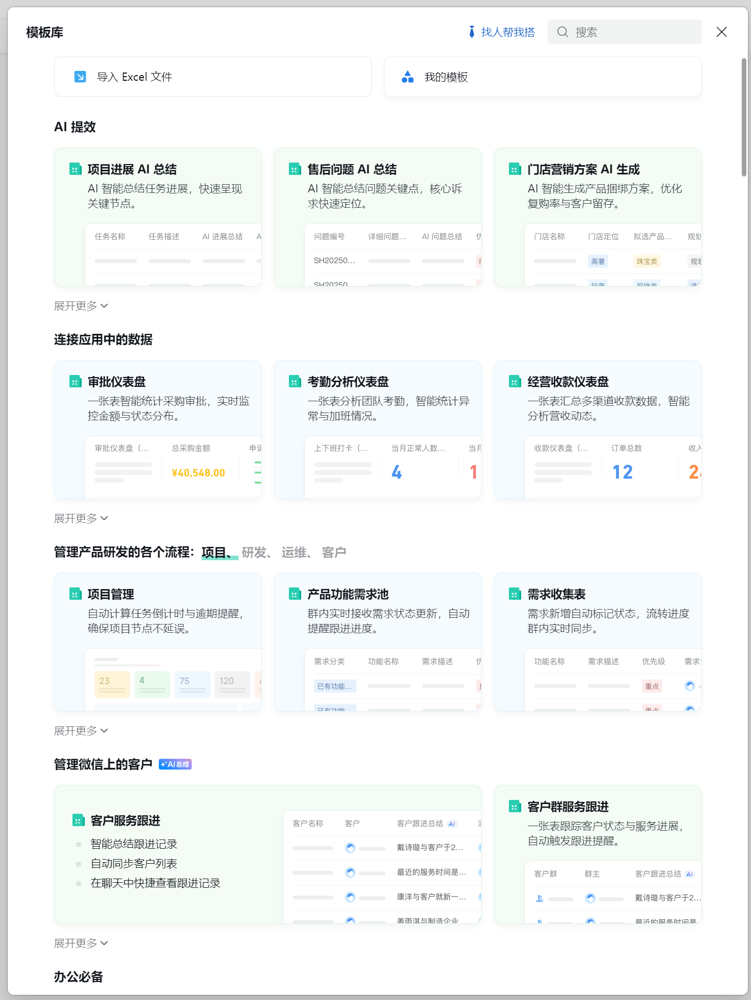

#### 2.5.4 导入表格

统一**导入任务模型** `ImportTask { sourceType: local|online|chat, fileKey/docId, status, resultTableId, error }`：三种来源共用解析管线（xlsx 解析 → 字段类型推断 → 建表 → 记录写入），仅取数适配器不同。本项目复用现有 ExcelParser + 导入向导。大文件分片上传 + 后端流式解析 + 行/列上限。


#### 2.5.5 设计规律

1. 三类创建模式：即时创建型 / 向导选择型 / 异步任务型；
2. 数据单向引用链：工作表是数据基座 → 仪表盘 widget、AI 报告 block 通过 `sourceTableId` 引用并复用同一聚合接口；收集表单是反向链路（外部填写 → 写回结果表）；导入是把外部数据物化为工作表；
3. AI 能力两层：字段级 AI（AI 字段）+ 文档级 AI（分析报告生成管线）。

---

## 3. 字段类型系统

### 3.1 类型全景（22 种业务字段 + 4 种系统字段 + AI 字段 = 26+1）

> 截图实测：类型选择面板中 26 种类型**同列表可选**（系统字段不隔离），「AI 字段」置顶于列表上方、带右箭头进入场景市场（§10）。

| 分组 | 类型 | type 标识 | 存储值 | 配置复杂度 |
|---|---|---|---|---|
| 基础 | 文本 | `text` | string | 无配置 |
| 基础 | 单选 | `singleSelect` | optionId | 选项集 / 引用+联动 |
| 基础 | 多选 | `multiSelect` | optionId[] | 同上 |
| 基础 | 数字 | `number` | number | 精度、千位符 |
| 基础 | 百分数 | `percent` | number | 同数字 |
| 基础 | 货币 | `currency` | number | 币种、精度、千位符 |
| 基础 | 进度 | `progress` | number | 颜色、范围、格式、显数 |
| 基础 | 日期 | `date` | timestamp(ms) | 格式、默认填充创建时间 |
| 协作 | 人员 | `member` | userId[] | 多人开关、通知开关 |
| 协作 | 群聊 | `groupChat` | chatId[] | 多群开关（本项目可降级为"部门/用户组"） |
| 媒体 | 图片 | `image` | attachment[] | 仅拍照上传开关 |
| 媒体 | 文件 | `file` | attachment[] | 无配置 |
| 关联 | 关联 | `relation` | recordId[] | 目标表、双向、多选、视图限定 |
| 标识 | 链接 | `url` | {url, text} | 展示样式 |
| 标识 | 电话 | `phone` | string | 无配置 |
| 标识 | 邮箱 | `email` | string | 无配置 |
| 标识 | 地理位置 | `location` | {lat,lng,addr} | 轻配置（二期） |
| 标识 | 复选框 | `checkbox` | boolean | 默认勾选、AI 判断 |
| 标识 | 条码 | `barcode` | string | 扫码录入（移动端） |
| 标识 | 自动编号 | `autoNumber` | string | 编号段规则 |
| 计算 | 公式 | `formula` | 缓存计算值 | 表达式 + 返回类型 |
| 计算 | 查找引用 | `lookup` | 缓存计算值 | 源表+条件+聚合 |
| 系统 | 创建人 / 最后编辑人 | `createdBy` / `lastModifiedBy` | userId | 只读 |
| 系统 | 创建时间 / 最后编辑时间 | `createdTime` / `lastModifiedTime` | timestamp | 只读 + 日期格式 |
| AI | AI 字段 | `ai` | 场景相关 | 场景 + 提示词 + 输入映射 |

### 3.2 统一的字段配置弹窗框架

所有类型共用同一弹窗骨架，前端用一个 `FieldConfigDialog` + 按类型挂载子表单实现：

```
[字段名称输入框]      ← 默认 = 类型名；重名自动追加序号（「数字 2」「创建人 2」）
[字段类型下拉]        ← 配置中途可切换类型，配置区动态重渲染
[类型说明文案]        ← 一行灰色提示，按类型注册（如人员「你可以在人员列类型@人」、
                        关联「你可以通过关联列获取其他智能表的数据」）
[类型专属配置区]      ← 0~N 个配置项（见 3.3）
[AI 辅助入口]         ← 左下角按钮（点击进独立配置流程，非内嵌展开）
[确定] [取消]
键盘流：↑↓ 选择类型、↵ 完成、Tab 再添加一列（批量建列效率设计）
```

**AI 入口逐类型映射**：文本/图片 =「使用 AI 生成」；单选/多选 =「使用 AI 匹配标签」；数字/百分数/货币/进度/日期 =「使用 AI 计算」；复选框 =「使用 AI 判断」；人员/群聊/文件/关联/系统字段 = 无。

**新建列的三个入口**：① 网格最后一列表头右侧的「+」占位列（tooltip「添加一列」，任何滚动位置可达，新建后仍可连续添加）；② 列头菜单「插入字段 ▸ 向左/向右插入」；③ 表格设置面板「+ 新增字段」。

**参考截图：**

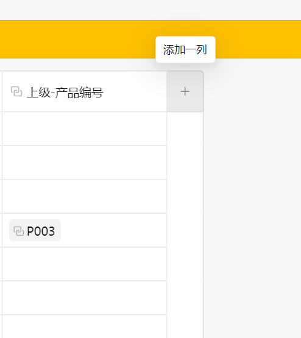

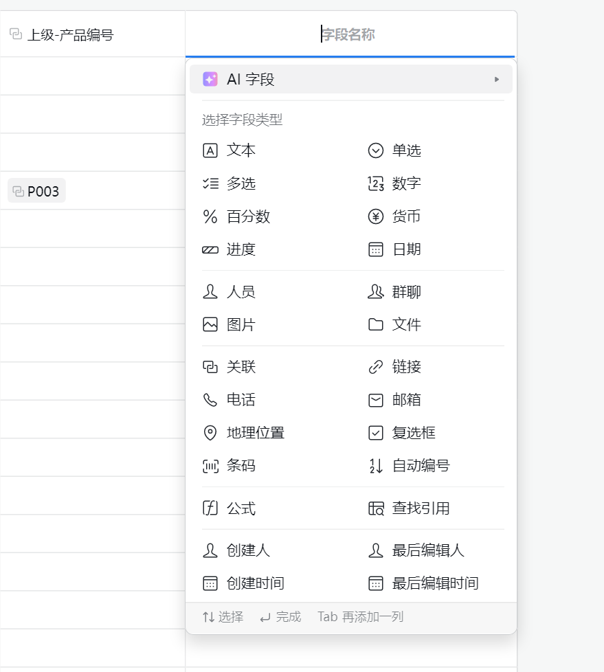


**数字家族无损转换**：数字/百分数/货币/进度四类型共享底层数值存储，弹窗内提供四枚「快捷转换」大按钮，一键改 type + 默认 config，已有数据零迁移。

### 3.3 各类型配置 Schema（逐类型）

#### 文本 `text`
无附加配置。可扩展 `maxLength` / `defaultValue`。AI 入口：使用 AI 生成。

#### 单选 `singleSelect` / 多选 `multiSelect`
```jsonc
{
  "optionSource": "manual",            // manual | reference
  "options": [                          // manual 模式：本地选项集
    { "id": "opt_1", "label": "重点", "color": "red", "order": 0 }
  ],
  "allowAddOptionWhenEditing": true,    // 填写人输入不存在的值时自动创建选项（默认开）
  "reference": {                        // reference 模式：引用他表选项集
    "tableId": "tbl_xxx",
    "fieldId": "fld_优先级"
  },
  "optionLinkage": {                    // 选项联动（级联下拉）
    "enabled": true,
    "match": "all",                     // all | any
    "conditions": [
      { "localFieldId": "fld_需求状态", "operator": "eq", "remoteFieldId": "fld_单位" }
    ]
  }
}
```
- 选项操作：新增 / 删除 / 拖拽排序 / 改色（预设色板）/ 就地改名；
- **引用选项**：选项集来自另一张表的某个单选/多选字段，源表变更自动同步；此模式下「允许填写时新增选项」**整块隐藏**（非置灰）；
- **选项联动**：本表当前行字段值与引用表行字段值比较，满足条件的引用行其值才作为可选项——实现「选了单位后，状态只显示该单位下的状态」的级联效果；
- AI 入口：使用 AI 匹配标签（把已有单元格文本归类到选项）。


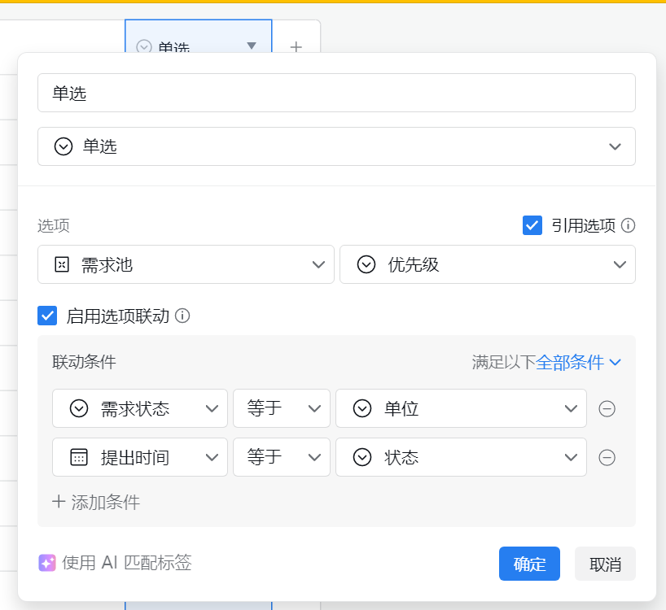


#### 数字 `number` / 百分数 `percent`
```jsonc
{ "precision": "default",              // default | 0 | 1 | 2 ...
  "thousandSeparator": false }
```
AI 入口：使用 AI 计算。

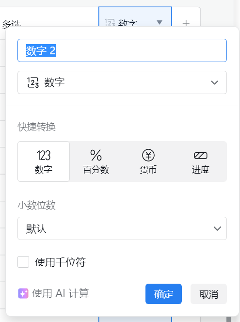

#### 货币 `currency`
```jsonc
{ "currencyCode": "CNY", "currencySymbol": "￥",
  "precision": 2, "thousandSeparator": true }   // 千位符默认开（与数字相反）
```
- 小数位下拉实时显示格式化预览（￥1.00）；币种仅显示元数据，不做汇率换算。

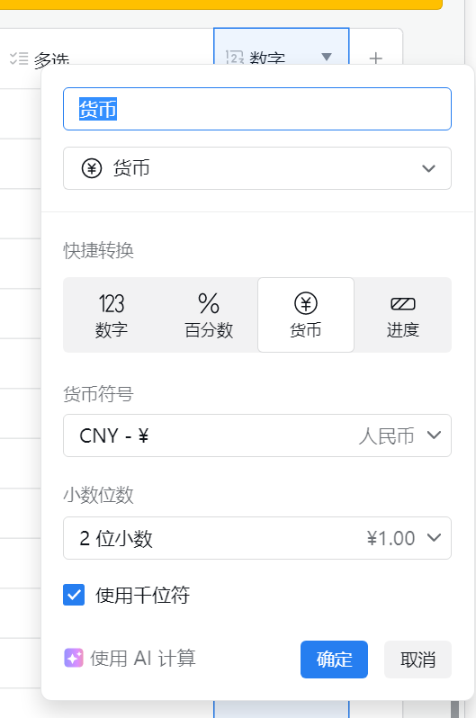

#### 进度 `progress`
```jsonc
{ "color": "green",                    // 9 单色 + 9 渐变/双色组合色板
  "numberFormat": "value",             // value | percent
  "precision": "default",
  "range": { "min": 0, "max": 100 },   // 自定义范围，不必 0-100
  "showNumber": true }
```
渲染比例 = `clamp((value-min)/(max-min), 0, 1)`。

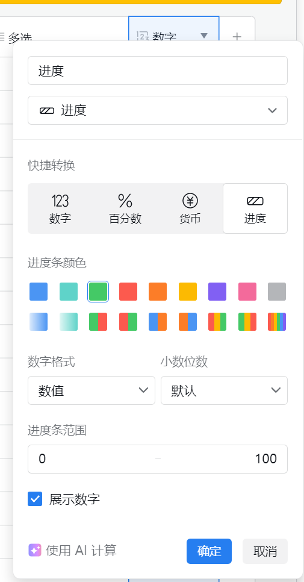

#### 日期 `date`
```jsonc
{ "format": "yyyy年M月d日",            // 示例式选项：yyyy年M月d日 / yyyy-MM-dd / yyyy/MM/dd / 含时分
  "includeTime": false,
  "autoFillCreatedTime": false }       // 开启后新建行自动写入当前时间
```
存储为 UTC 毫秒时间戳，按租户时区+格式配置显示。


#### 人员 `member`
```jsonc
{ "multiple": true,          // 默认开
  "notifyOnAdd": true }      // 默认开：赋值后向该成员发通知（协作导向）
```
- 单元格内支持 `@` 唤起选人；值存 userId[]，渲染时 join 用户表取头像/姓名；成员离职降级显示（灰名）。


#### 群聊 `groupChat`
```jsonc
{ "multiple": false }        // 默认单选（与人员相反：群聊是归属场景，人员是分派场景）
```
> 本项目无企业微信群概念，一期可**降级实现为「部门/用户组」字段**（对接现有 departments 模块），或暂缓。


#### 图片 `image`
```jsonc
{ "cameraOnly": false }      // 仅限手机拍照上传：现场取证防造假场景
```
值：附件对象数组 `[{fileId, url, name, size, width, height}]`。展示为缩略图墙 + Lightbox 预览。


#### 文件 `file`
无配置。值同图片（附件数组），展示为文件图标 + 文件名 chip。


#### 关联 `relation`
```jsonc
{ "targetTableId": "tbl_需求池",
  "bidirectional": true,           // 「在 XX 表显示」：对端表自动创建反向关联列
  "reverseFieldId": "fld_自动生成",
  "multiple": true,
  "limitToView": { "enabled": false, "viewId": null } }  // 限定可关联行范围
```
值：`recordId[]`，渲染取对端行主列值做徽标。详见 §8。

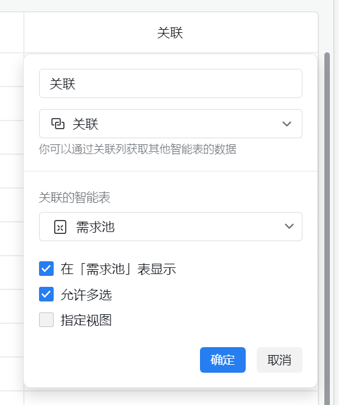

#### 链接 `url`
```jsonc
{ "displayStyle": "iconText" }     // text | iconText
```
值 `{url, text}`；录入时 URL 校验 + 协议头自动补全。

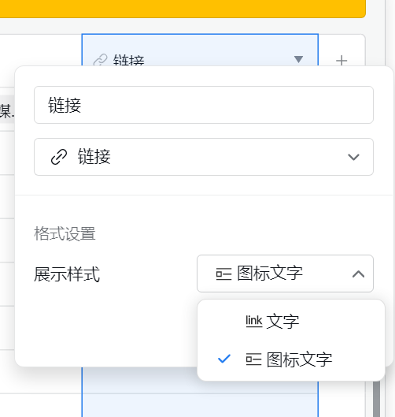

#### 电话 `phone` / 邮箱 `email`
零配置。录入校验（手机号/座机正则、email 格式）；校验失败**红点提示而非强制拦截**（宽松策略）。


#### 复选框 `checkbox`
```jsonc
{ "defaultChecked": false,                          // 仅作用新增行初始值
  "aiJudge": { "enabled": false, "prompt": "",
               "triggerOn": ["rowCreate", "refFieldChange"] } }
```
> 「使用 AI 判断」是弹窗**左下角按钮入口**（与公式的「使用 AI 生成公式」同位），点击进独立配置流程，而非弹窗内嵌展开的配置区。


#### 条码 `barcode`
移动端扫码录入；值 string。（二期）

#### 自动编号 `autoNumber`
```jsonc
{ "numberType": "autoIncrement",       // autoIncrement | custom
  "applyToExisting": true,             // 改规则后是否批量重算存量行
  "segments": [                        // custom 模式：有序编号段，拖拽排序，实时预览
    { "type": "autoIncrement", "digits": 3 },       // 位数=补零宽度 → 001
    { "type": "fixedText", "text": "-" },
    { "type": "createDate", "format": "yyyyMMdd" }
  ] }
```
- 行创建时服务端生成，只读；删除行不回收号码；
- 自增段需**表级原子计数器**（每列一个，防并发重号）；
- 「将修改应用于已有编号」勾选 → 保存时触发存量批量重算（异步任务）。

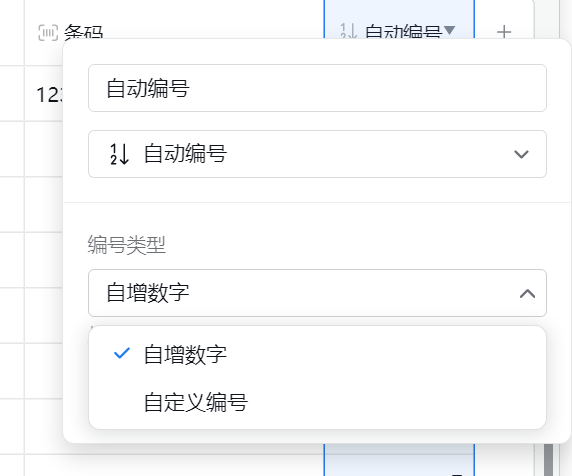

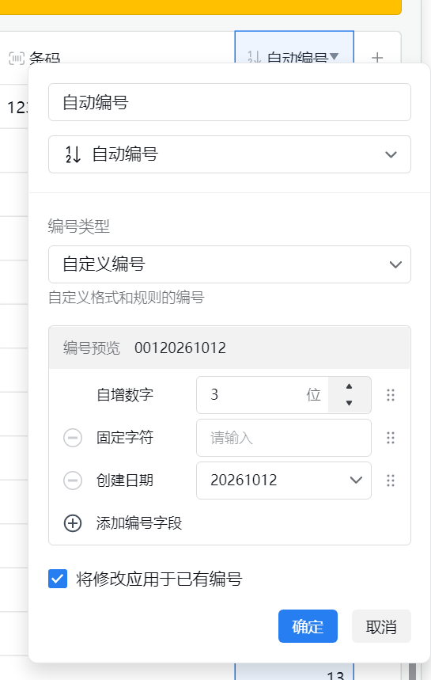

#### 公式 `formula`
```jsonc
{ "expression": "ADD({fld_a}, {fld_b})",   // DSL 字符串，字段以 {fieldId} 引用
  "referencedFieldIds": ["fld_a", "fld_b"], // 依赖图用
  "returnType": "number" }
```
入口弹窗只有「编辑公式」按钮（打开全屏公式编辑器）+「使用 AI 生成公式」。详见 §9。

#### 查找引用 `lookup`
```jsonc
{ "sourceTableId": "tbl_xxx",
  "sourceViewId": null,
  "sourceFieldId": "fld_spec",
  "conditionLogic": "and",
  "conditions": [
    { "sourceFieldId": "fld_creator", "op": "eq",
      "rightType": "field",                 // field | const（UI 上的 A⇄ 切换）
      "rightFieldId": "fld_creator", "rightValue": null }
  ],
  "aggregation": "raw" }    // raw 原样引用 | rawDistinct 去重引用 | sum | count | countDistinct | avg | max | min
```
详见 §8。

#### 系统字段 `createdBy` / `lastModifiedBy` / `createdTime` / `lastModifiedTime`
- 弹窗只有列名 + 说明文案（「自动展示每行记录的创建人，不可修改」）+（时间类）日期格式；
- **同类型可添加多个**（自动命名「创建人 2」），值相同；
- 关键纪律：**公式/查询引用/AI 的自动回填不得更新「最后编辑人/时间」**——只有人工编辑（含批量编辑、表单提交）才更新，否则审计语义被系统计算污染；
- 实现上建议系统四值直接落在记录级 `sysMeta`（见 §14），字段定义只控制「是否展示该列」。


#### AI 字段 `ai`
```jsonc
{ "scenarioId": "tagMatch",            // null = 自定义
  "customPrompt": "你是一个文本分类专家。…",
  "inputs": [{ "placeholder": "文本", "fieldId": "fld_text" }],
  "outputType": "singleSelect",        // 输出类型决定本列的渲染器
  "outputOptions": { "autoCreateOptions": true, "options": [] },
  "trigger": { "onCreate": true, "onInputChange": true, "manualRefresh": true },
  "tools": ["webQuery", "fileParse"] }
```
详见 §10。

### 3.4 FieldTypeRegistry —— 前端注册表模式

字段类型驱动一切 UI 行为，集中注册：

```ts
registry[fieldType] = {
  icon, label, group,                       // 类型选择面板的图标/名称/分组
  defaultConfig: () => object,
  ConfigForm: Component,                    // 字段配置弹窗的专属区
  CellRenderer: Component,                  // 展示态
  CellEditor: Component | 'blocked',        // 编辑态（系统字段/lookup = blocked）
  FormWidget: Component,                    // 表单控件映射
  filterOperators: Operator[],              // 可用筛选运算符
  FilterValueEditor: Component,
  groupable: boolean,                       // 图片/文件不可分组
  sortable: boolean,
  directionLabels: [ascLabel, descLabel],   // 选项正序/逆序、0→9/9→0、A→Z/Z→A
  sortComparator: (a, b) => number,
  groupValueRenderer: (value, meta) => VNode,  // 分组标题渲染：单选→彩色标签、人员→头像+姓名、其他→"字段名: 值"
  aggregateTypes: AggType[],                // 数值列支持 sum/avg…，其他 count
  permissions: { editable: bool, firstSubmittable: bool },  // 公式/系统字段强制只读
}
```

---

## 4. 单元格编辑器体系

### 4.1 六种交互形态（按提交策略分类）

| 类别 | 字段类型 | 提交时机 | 浮层 |
|---|---|---|---|
| A. 即时切换 | 复选框 | 单击即取反提交，无编辑态 | 无 |
| B. 内联输入 | 文本、数字、百分数（带 % 后缀）、电话、邮箱 | 失焦/回车提交，Esc 取消 | 无 |
| C. 内联滑块 | 进度（拖动手柄实时更新数值） | 松开/失焦提交 | 无 |
| D. 浮层选择器 | 单选、多选、日期、人员、群聊 | 单选：点选即提交并关闭；多选/人员：外点关闭提交 | 下拉 Popover |
| E. 浮层面板 | 图片、文件（上传）、关联（记录卡片选择） | 异步完成后回填 | 中型 Popover |
| F. 浮层表单（显式确认） | 链接（显示文本 + URL 双字段） | 点「确认」 | Popover 表单 |
| G. 不可编辑拦截 | 创建人/编辑人/创建时间/编辑时间、查找引用、公式 | 不产生编辑，弹气泡提示 + 「修改设置」深链 | 提示气泡 |

### 4.2 核心状态机与组件契约

```
display ──单击/双击/Enter──▶ editing ──commit──▶ display（乐观更新 + 落库）
   ▲                          │
   └────────── Esc/外点取消 ───┘
```

编辑器注册表统一契约：

```ts
interface CellEditorProps {
  value: unknown;
  field: FieldMeta;            // 含 config
  record: Record;              // 行上下文（联动/权限判断用）
  onCommit(value): void;
  onCancel(): void;
  anchorRect: DOMRect;         // 浮层定位
}
```

组件复用矩阵：
- 单选/多选共享 `SelectEditor`（`multiple` 开关）；
- 人员/群聊共享 `PickerEditor`（数据源不同）；
- 文本/电话/邮箱/百分数共享 `InlineTextEditor`（validator/icon/action 参数化）；
- 图片/文件共享 `UploadEditor`（accept/上传通道参数化）；
- 系统字段/查找引用共享 `BlockedEditor`（提示文案参数化）。

### 4.3 各编辑器详细交互（截图实测）

**多选**：单元格内 tag 列表（可 × 删除）+ Popover（顶部字段名标题行 + 「查找选项」搜索框 + 复选列表）；勾选与 tag 双向实时同步，无确认按钮；键盘 ↑↓/Enter/Esc。

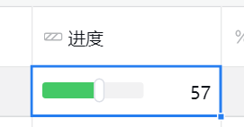

**单选**：占位「请选择」；Popover 顶部同样有字段名标题行；搜索框文案「查找**或添加**选项」——搜索词无匹配时出现「创建"xxx"」项（受 `allowAddOptionWhenEditing` 控制）；点选立即提交并关闭。

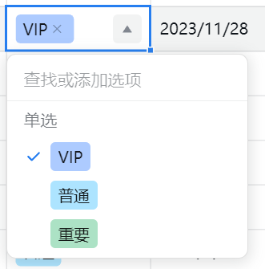

**百分数**：内联输入，右侧固定 % 后缀（只读），失焦/回车提交。

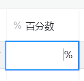

**日期**：双通道输入——① 文本框直接键入（占位提示即格式：「YYYY年M月D日」，按列格式容错解析）；② 日历浮层：年/月下拉 + ‹ › 翻页 + 周一起始日期矩阵 + 溢出日期置灰可点 + 今天高亮 + 底部「◎ 今天」快捷键。值存时间戳。


**人员**：两级入口——轻量浮层（「搜索成员」+「文档成员」分组列表，高频优先）→ 底部「从通讯录选择...」打开**双栏 Modal**（左栏：搜索 +「从群聊中选择」入口 + 群→成员层级勾选，成员行可带身份徽标如「创建人」及名片图标；右栏：「已选择 N 个联系人」+ × 移除；底部「确定 / 取消」，确定一次性回填）。


**群聊**：浮层列表行渲染复合信息：叠放头像 + 群名(成员数) + 成员范围徽标（如「全员」）+ ⓘ 详情；搜索框旁「＋」可新建群。


**关联**（最复杂编辑器）：单元格内竖向堆叠关联 chip（🔗 链接图标前缀 + 截断标题 + ×，可滚动）+ 下方大浮层展示**候选记录卡片**（目标表记录渲染为卡片：标题 + 若干摘要字段，呈「字段名标签 + 值」网格，值按类型渲染——单选→彩色 tag（可出现多次）、人员→头像+姓名，与网格单元格渲染同源）；底部「＋ 请重新选择」追加。

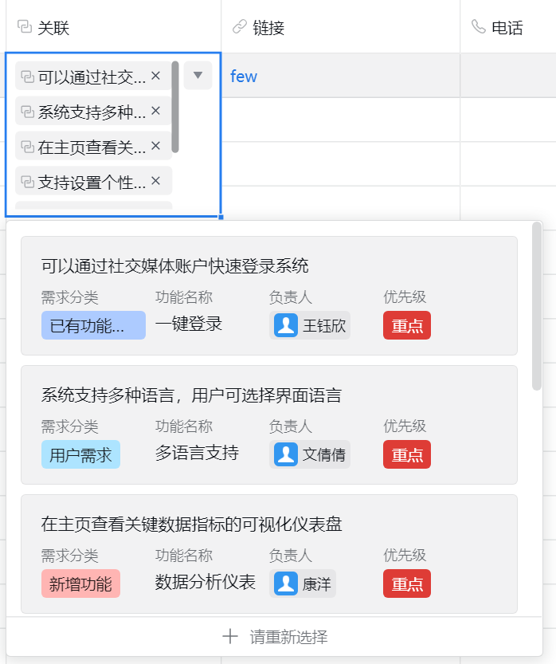

**图片/文件**：虚线拖放区（dragover 高亮）+「＋ 添加文件」按钮；图片额外提供「🖼 添加本地图片」「📱 手机相册上传」双通道（跨端：生成二维码/推送，手机选图回传，二期）。


**链接**：少数**非即时提交**编辑器——浮层表单「显示文本 + 链接」双输入，确认/取消；URL 校验不通过时确认禁用；显示文本为空默认用 URL；展示态 `<a target="_blank" rel="noopener">`。


**电话/邮箱**：内联输入自动换行撑高单元格；行内类型图标兼作快捷动作（tel:/mailto: 或复制）。


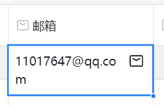

**进度**：展示态与编辑态共用渲染（条 + 数值），编辑态多可拖手柄；支持方向键微调（±1，Shift±10）。

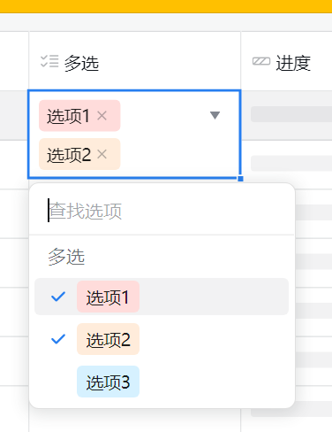

**复选框**：单击即取反并立即提交，展示态即编辑态。


**不可编辑拦截**：点击系统字段/查找引用单元格 → 不进入编辑态 → 气泡提示「创建人字段不可直接编辑 / 查找引用内容不可直接编辑」+ 蓝色「修改设置」链接（深链到字段配置弹窗），数秒自动消失或外点关闭。


### 4.4 浮层基础设施（统一 Popover 容器）

- 锚定单元格下缘，空间不足向上翻转（箭头 ▾ ↔ ▲ 同步切换）；
- 外点关闭（提交 onBlur 类）/ Esc 取消；
- 滚动跟随单元格；z-index 分层（Popover < Modal，人员浮层之上可再开通讯录 Modal）；
- 大列表（选项/成员/关联记录）内部虚拟滚动 + 搜索过滤。

---

## 5. 视图系统

视图 = 数据之上的一层配置投影。计算管线（全链路 memoized）：

```
records（原始数据）
  → permissionFilter（行列权限裁剪，§13）
  → filter（筛选 DSL 求值）
  → groupTree（多级分桶 + 组内排序 + 自底向上聚合）
  → sort（多级稳定排序，树形下仅同级）
  → flatten（折叠态展开为行序列：[GroupHeader, ...DataRow, AddRow]）
  → render（CellRenderer 分发；fillRules 在渲染时求值注入背景色）
  → summaryRow（底部汇总：记录数 + 各列聚合）
```

### 5.1 筛选

**配置流程**：选字段（FieldPicker，带全部字段类型图标）→ 选运算符（按类型过滤）→ 选/填值（编辑器按类型分发）→ 即时生效。

**运算符**（单选字段实测，其余类型按此扩展）：
`包含 / 不包含 / 等于 / 不等于 / 为空 / 不为空`；数字/日期补 `> ≥ < ≤ 介于`；日期补相对值（今天/本周/本月…）。

**查询 DSL**（前后端同构，可编译为 JS 求值器或 SQL）：

```ts
interface FilterConfig {
  conjunction: 'and' | 'or';          // 一期默认 and，结构预留 or/嵌套组
  conditions: FilterCondition[];
  scope: 'personal' | 'shared';       // 「调整仅你可见」|「对所有人生效」
}
interface FilterCondition {
  id: string;
  fieldId: string;
  operator: Operator;
  value?: unknown;                    // 单选: optionId[]；文本: string；数字: number；日期: 时间戳或相对描述
  pinned?: boolean;                   // 固定到工具栏成为条件胶囊
  collapsed?: boolean;
}
```

**语义要点**：
- 枚举字段「包含」+ 多值 = `value ∈ set`（OR 语义）；「为空/不为空」无值，值编辑器隐藏；
- `isEmpty` 需覆盖 `null / '' / []`；
- **作用域**：「仅你可见」写用户个人偏好；「对所有人生效」写共享视图配置（需编辑权限）；UI 为分段胶囊控件（`调整仅你可见 | 对所有人生效`，选中蓝底）+ 独立 `···` 更多按钮；
- **条件胶囊（chip）**：pinned 的条件平铺在**左上工具栏**（胶囊 = 字段类型图标 + 字段名 + ▾，如 `⊙ 产品名称 ▾`）；**pin 的唯一入口是条件行上的图钉图标**（条件行右侧还有 ⊖ 删除、∧ 折叠）；点击胶囊打开的是**精简面板**（无字段切换行，直接运算符 + 值列表，图钉呈已固定态），与完整面板（含字段行 + 三操作图标）是两个形态；筛选生效的列，列头漏斗图标变蓝，筛选按钮高亮——多处是同一筛选模型的投影，需状态同步；
- 右键菜单「只看此内容/不看此内容」= 快捷生成等值/不等值筛选条件（§7）。

**值编辑器**：单选/多选 = 选项勾选列表（带色块、可搜索、「已选择 N 项 / 清空」）；文本 = 输入框；数字 = 数字框；日期 = 日期选择器或相对日期下拉。

**参考截图：**

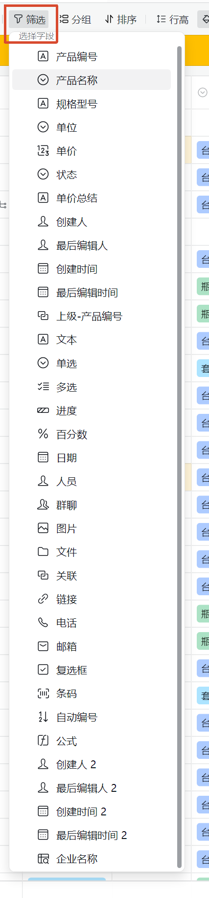

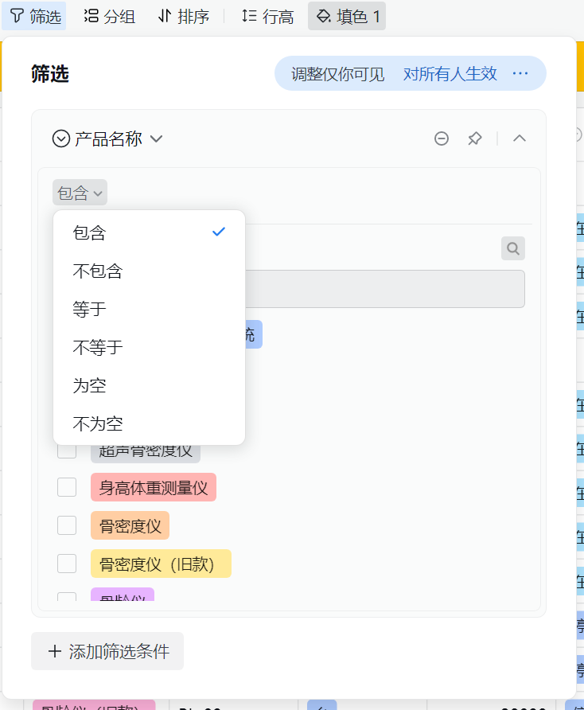

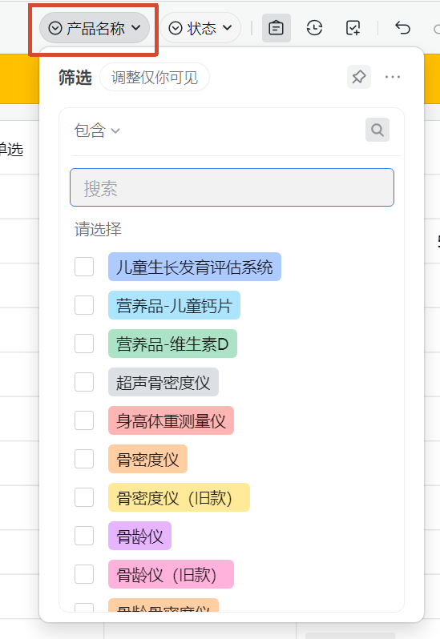

### 5.2 分组

```ts
interface GroupLevel { fieldId: string; direction: 'asc' | 'desc' }
// groups[] 数组序 = 层级序（外层→内层），面板中拖拽手柄调整
```

- 最多实测 3 级（产品名称 → 日期 → 文本）；方向文案随类型：单选=选项正序/逆序，数字/日期=0→9/9→0，文本=A→Z/Z→A；
- **渲染**：每组一行跨列 GroupHeader（折叠三角 + 组值 + `记录数 N` + 各数值列组内聚合，聚合值显示在对应列位、带「求和」前缀，且最深层组头聚合值右侧带 ▾——可就地切换聚合方式），逐级缩进；每组末尾 `+` 行支持**组内新增**（自动回填各层分组字段值）；
- **组值渲染分发**：单选→彩色标签（超长省略）、人员→头像+姓名（实测人员字段可分组）、其他→`字段名: 值`，空值→`字段名: 空`；
- **行号全局连续**（跨组递增）；组间留白分隔；最深层标题行带 `···` 菜单；
- **空值归组**：`null/'' → EMPTY_GROUP`，排序位置定义为最前；
- **聚合**：叶子组先算，父组复用子组结果累加（sum/count 满足结合律；avg 需保留 sum+count 中间量）；
- 折叠状态以 groupPath（各层键数组）存视图 UI 状态，不入数据；
- 工具栏「分组」按钮外显层级数徽章（如 `分组 3`），激活态蓝底；
- **不可分组字段**：截图实测字段选择器中全部字段（含图片/文件）均同样式可选、无置灰；`groupable: false` 元数据作为**设计预留**保留（用于未来限制图片/文件分组），一期不做置灰；
- 底部全局统计行不受分组影响，恒为筛选后全集的统计。

**数据处理**：

```ts
buildGroupTree(rows, levels, depth=0):
  按 levels[depth].fieldId 取键（空 → EMPTY）
  桶排序：枚举按选项定义序 ± direction；数字/日期按值；文本按 ICU 中文排序
  children = 递归 buildGroupTree(bucket, levels, depth+1)
  聚合自底向上：{ recordCount, [fieldId]: sum|count|... }
flatten(tree, collapsedKeys) → 虚拟列表行序列
```

**参考截图：**

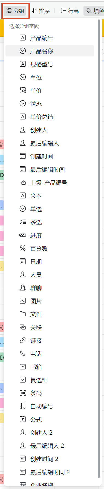

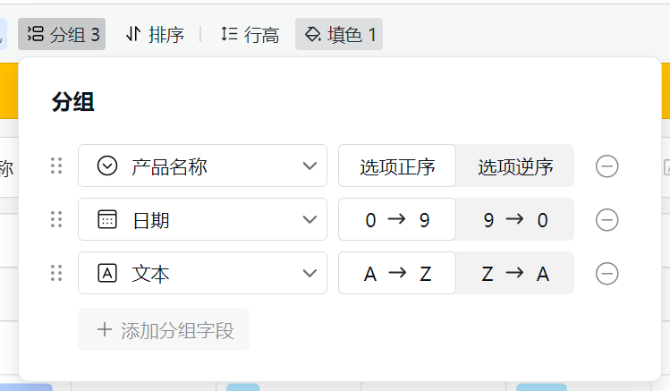

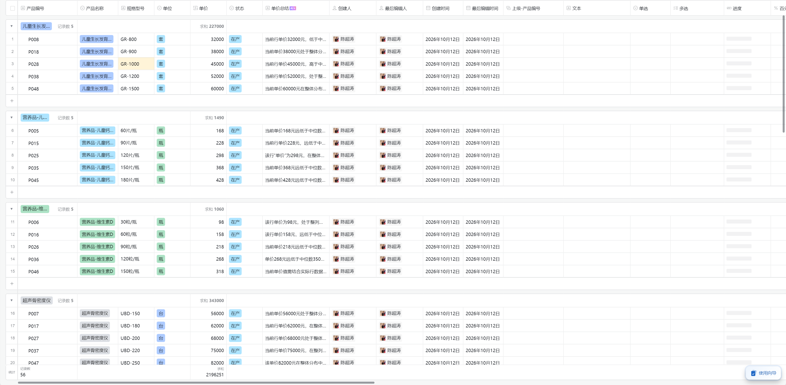

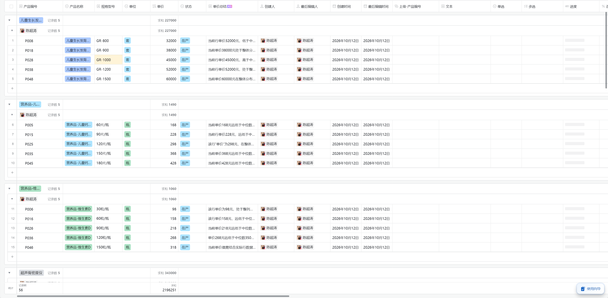

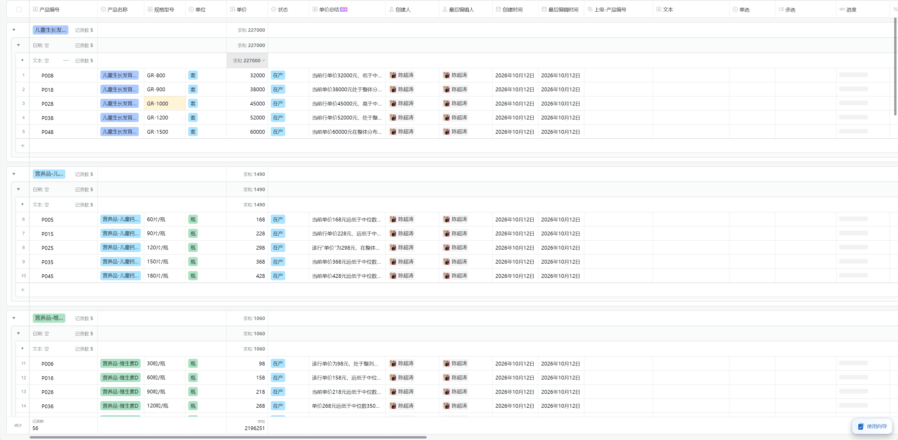

### 5.3 排序

- 面板：规则行 = 拖拽手柄 + 字段 + 方向按钮组（文案同分组，类型自适应）+ ⊖；`+ 添加排序字段`；

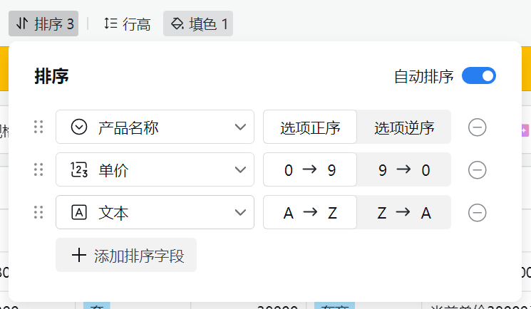
- 多字段按列表顺序为主/次/再次排序键，稳定排序；
- **「自动排序」开关**：开启 = 数据变更后实时重排；关闭 = 规则暂存但不自动应用（避免编辑中行跳动），维护 dirty 标记并在工具栏提示「排序已过期，点击应用」；
- 树形层级下排序**仅同级**生效；
- 表头菜单「排序 ▸」子菜单与面板联动，菜单项右侧回显当前排序方式。

### 5.4 行高

预设四档 `默认/中等/高/超高`（映射像素如 32/48/72/96）+ **自定义 N 行**（内容行数）。实现：`-webkit-line-clamp: N` 截断文本；虚拟滚动按统一行高算偏移，自定义时重算映射。

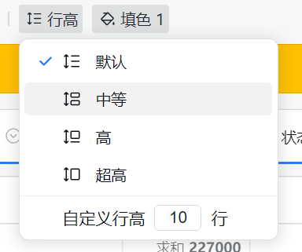

### 5.5 填色（条件格式）

规则行 = `字段 + 运算符 + 值 → 颜色`：

```ts
interface FillRule {
  id: string; fieldId: string;
  operator: 'contains'|'notContains'|'eq'|'neq'|'empty'|'notEmpty';
  value?: unknown;
  scope: 'cell' | 'fieldName';   // 「所有内容」|「字段名称」（作用于单元格或列头）
  color: string;                 // 预设浅色系色板 + 自定义
  order: number;                 // 拖拽排序 = 优先级
}
```

- 命中条件的单元格注入 `backgroundColor`（实测效果：浅黄/浅绿底色）；
- 多条并存，按 order 依次覆盖；
- **scope 的 UI 位置**：在运算符下拉菜单顶部并列「所有内容 / 字段名称」两项（分隔线下才是筛选运算符组）；色块带下拉箭头（色板入口）；
- 值控件随字段类型分发（文本=输入框，单选=选项下拉，数字=数字框）；
- 仅影响本视图显示，不改数据；徽章 `填色 N` 外显**生效规则数**——条件未填完整的规则不生效、不计入徽标；
- 渲染期求值，memoized selector 避免全表重算。

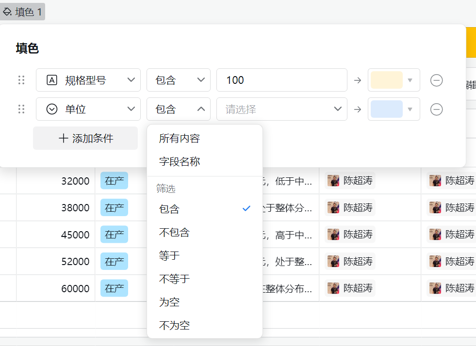

另有表头菜单的**整列填色**（§6）：`为所有内容填色`（列 body 背景）/ `为字段名称填色`（列头背景）——无条件、整列生效，与规则填色是两个独立机制。

### 5.6 视图级配置总表

| 配置 | 作用域 | 存储 |
|---|---|---|
| 筛选 / 分组 / 排序 / 填色 / 行高 | 视图（共享）或个人覆盖 | views.config / user_view_prefs |
| 字段显隐 / 字段顺序 / 列宽 / 冻结 | 视图 | views.config |
| 整列填色（header/body） | 视图 | views.config.columnStyles |
| 底部汇总聚合方式 | 视图 | views.config.aggregations |
| 全局外观（分组交替灰/白色带等斑马纹） | 视图 | views.config.style |
| 分组折叠态 | 会话 UI 态 | 前端内存/localStorage |

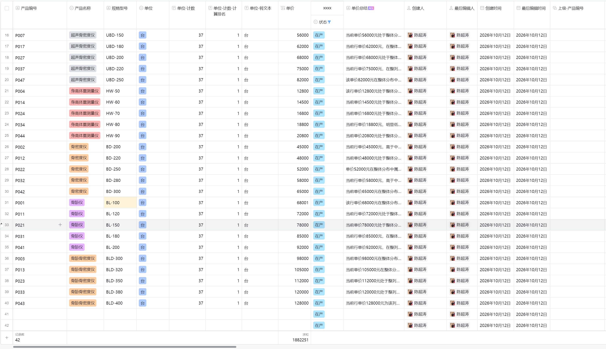

---

## 6. 列操作与表头工具栏

### 6.1 列头下拉菜单完整清单（点击列头 ▾ 触发）

```
├─ 修改字段                       → 打开字段配置弹窗（§3.2）
├─ 插入字段 ▸                     → ← 向左插入 ｜ → 向右插入（新列直接进入类型选择）
├─ 筛选                           → 打开该列的筛选面板（§5.1）
├─ 分组 / 取消分组                → 互斥状态项；不支持的类型置灰
├─ 排序 ▸（右侧回显当前方式）      → 选项正序/逆序（文案随类型）
├─ 整列填色 ▸                     → 为所有内容填色 ｜ 为字段名称填色
├─ 新建编组                       → 弹窗：编组名称 + 包含字段（默认含当前列）
├─ 移入编组 ▸                     → 存在编组时出现，列出全部编组（已在组内则为「移出」）
├─ 根据此列…（分组标题）
│   ├─ 内容权限 ▸ [限时免费]       → 全员权限对话框（§13）
│   ├─ 数据可视化 ▸
│   │   ├─ 视图：新建看板（按选项分类查看）
│   │   └─ 图表：添加柱状图（按选项统计行数）▸ ｜ 添加饼图（按选项统计占比）▸ ｜ 添加更多图表…
│   ├─ 使用公式计算 ▸              → 基于本列生成公式字段
│   ├─ 内容变更时提醒              → 记录变更提醒精简弹窗（§11.3）
│   └─ 生成人员字段                → 基于本列生成人员类型字段
└─ 底部快捷图标栏（icon + tooltip）
    ├─ 创建副本   ├─ 自动调整列宽   ├─ 冻结至此列   ├─ 隐藏   └─ 删除（红色）
```

**参考截图：**


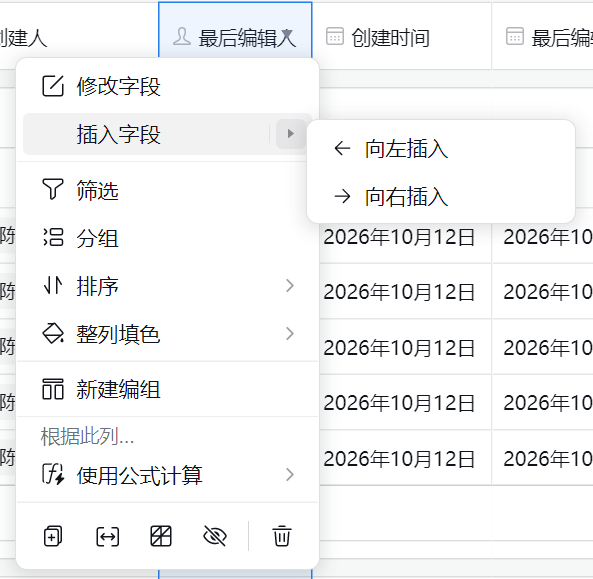


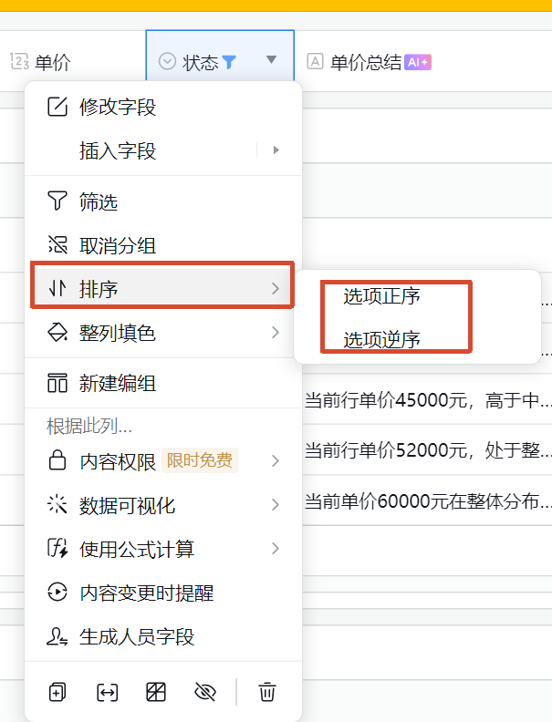

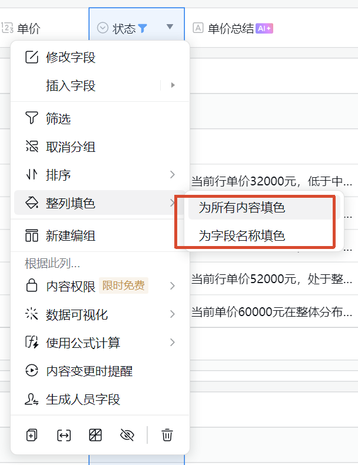

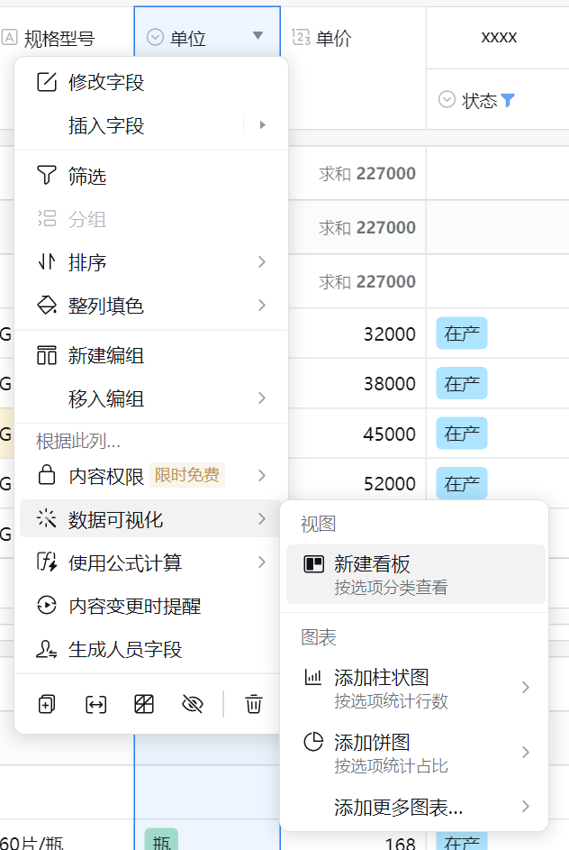

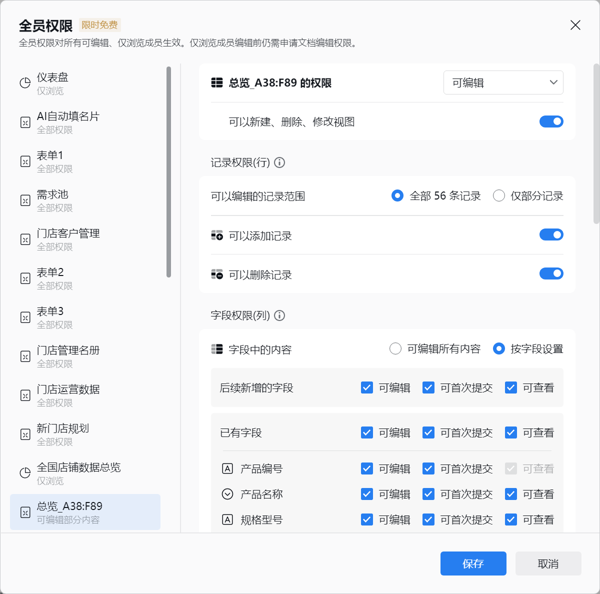

**菜单动态行为规则**：
- 状态互斥：分组↔取消分组同槽位；状态回显：排序项右侧显示当前方式，筛选生效列漏斗变蓝；
- 条件出现：「移入编组」仅在已有编组时出现；
- 类型驱动：排序文案/筛选运算符/可视化可选项全由 FieldTypeRegistry 决定；**「根据此列」区也按类型裁剪**——系统字段列（如最后编辑人）该区内仅剩「使用公式计算」，内容权限/数据可视化/内容变更时提醒/生成人员字段均不出现；
- 营销标签位：「限时免费」标签机制（为付费分层预留，见定价文档）。

### 6.2 快捷图标栏语义

| 图标 | 功能 | 实现要点 |
|---|---|---|
| ⧉ 创建副本 | 复制当前列 | 复制字段配置 + 单元格数据，名称加「副本」；公式/lookup 副本需重映射引用 |
| [→\|←] 自动调整列宽 | 按内容算宽 | 取列头与内容最大宽度（设上限）；列边界双击同效 |
| ❄ 冻结至此列 | 冻结该列及左侧 | 视图级 `frozenFieldId`；冻结线穿过编组时整组冻结 |
| 🚫👁 隐藏 | 视图级隐藏 | 写入 `fieldVisibility`；≠ 权限「可查看=false」（后者强制、接口层裁剪） |
| 🗑 删除 | 删除字段 | 二次确认 + 级联依赖检查（§2.4） |

**快捷图标 tooltip 截图：**


### 6.3 列编组（多级表头）

- 实体：`ColumnGroup { id, name, fieldIds[] }`；字段最多属于一个编组；
- 表头两层渲染：组头 colSpan = 成员可见列数（成员隐藏时动态收缩），字段头保留图标/筛选漏斗/▾ 菜单；
- 编组表头右键菜单：修改编组（名称 + 成员多选维护 + 解散编组）、插入字段、创建副本、冻结至此编组、自动调整列宽、隐藏（整组）、解散编组（组头去掉，字段保留）；
- 在「展开记录」详情面板中，编组渲染为可折叠的分组节（带竖向层级线）。

**参考截图：**


---

## 7. 记录操作

### 7.1 添加行的四个入口

1. 工具栏「+ 添加一行」：在**数据区顶部**插入（新行行号为 1）并自动聚焦首列进入编辑态（白输入框 + 蓝色 2px 聚焦边框 + 右下填充柄）；
2. 行 hover 行首 `+`：在该行下方插入；
3. 底部汇总行左侧 `+`：追加到末尾；
4. 分组视图每组末尾 `+`：组内新增并回填分组字段值。


**与视图规则的冲突策略**：新空行在筛选/分组下可能不可见——一期采用「暂存置顶区」：新行不参与筛选直到首次提交；空行未填写直接离开时自动丢弃。

### 7.2 单元格右键菜单（记录级）

```
├─ 展开记录          → 记录详情抽屉（§7.3）
├─ 只看此内容         → 快捷筛选 =此值（生成条件胶囊）
├─ 不看此内容         → 快捷筛选 ≠此值
├─ 数据可视化 ▸       → 基于该字段快速出图表
├─ 设置提醒 ▸         → 行级提醒（如日期字段到期提醒）
├─ 添加子记录         → 创建层级子行（§7.4）
├─ 创建副本           → 复制此记录
├─ 向上插入 [1] 行    → 行数可编辑，批量插入
├─ 向下插入 [1] 行
└─ 删除
```

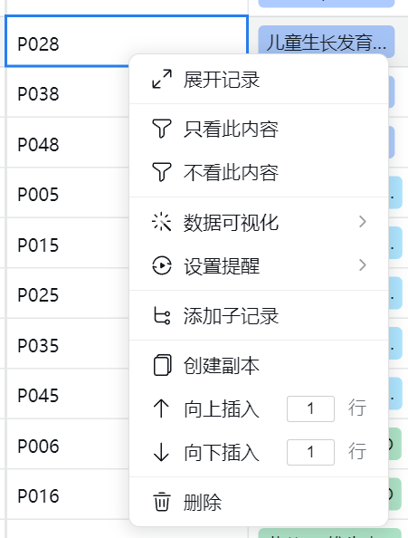

菜单项按字段类型动态裁剪（日期字段才有到期提醒）。

### 7.3 展开记录（详情抽屉）

- 全字段纵向表单式面板：左字段名+类型图标，右值/编辑器（复用 CellEditor）；
- 顶部：标题（主列值）、∧/∨ 上一条/下一条（遵守当前筛选/排序上下文）、⋯ 更多、收起；
- 编组渲染为可折叠节；空值显示类型化占位文案（「请输入」「请选择记录」「添加图片」…；进度字段空值渲染为空进度条控件）；
- 公式/查找引用字段**纯值只读渲染**：有值直接显示值，空值显示「-」；（「公式计算结果不可直接编辑」「查找引用内容不可直接编辑」提示文案出现在**表单**题目占位中，见 §12.2，详情抽屉中不出现）；
- 系统字段（创建人/时间等）自动维护、只读。

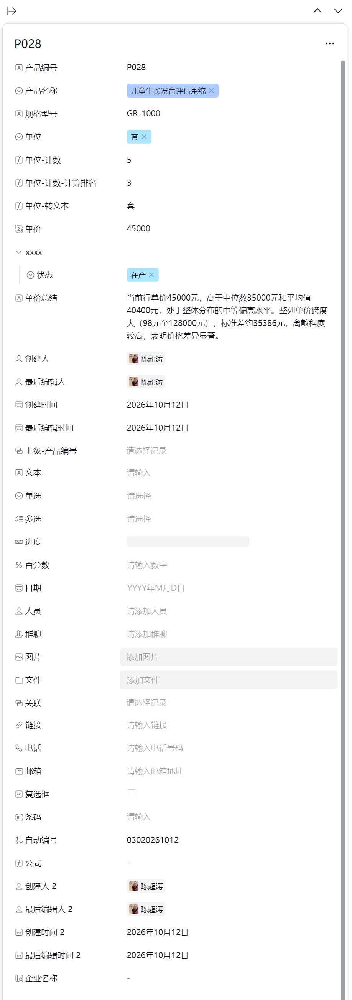

### 7.4 子记录（树形层级）

- 数据层：自关联字段（如「上级-产品编号」）存父记录 ID；「表格设置 → 父记录字段」指定哪个关联字段承载层级；
- 「添加子记录」= 插入新行并自动回填 parent 引用（UI 上回填父行主列值如 P003）；
- 渲染：父行折叠三角 ▾ + 子行缩进 + 左缘竖向虚线引导线 + 父行子计数徽标「⤦ N」；
- 折叠态为视图 UI 状态；子记录本质是普通行，其他视图可见；
- **边界规则**：环检测（A 的上级不能是 A 的后代，保存时校验拒绝）；删除父行策略 = 孤子上提一级（可选一并删除，二次确认）；排序在树形下仅同级。

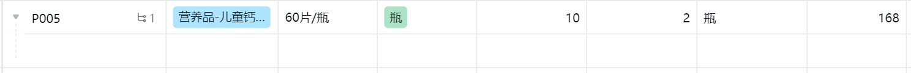

### 7.5 查找替换

右上 🔍 弹出卡片：「输入查找内容」+「替换为」+ [查找] [替换] [全部替换]（后两者未查找前置灰）。

- 一期全表文本匹配 + 逐个定位高亮滚动；大表按可见范围 + 后台分片扫描；
- 替换必须进入撤销栈，并触发「记录内容变更」自动化事件；
- 二期：区分大小写/全字匹配/限定列。


### 7.6 撤销 / 重做

- 命令栈（Command Pattern）：单元格编辑、行插删、查找替换、字段插删均入栈；
- 协同场景按操作者隔离（一期单租户小团队可简化为文档级栈）；
- 自动化/AI 的批量写入**不入用户撤销栈**（或聚合为一条「自动化执行」记录）。

### 7.7 行多选与批量操作

行首复选框进入多选模式后，工具栏切换为批量操作条：批量删除 / 批量修改字段值 / 批量导出。批量修改走统一写入管线（触发自动化、权限逐行复核）。

---

## 8. 关联与查询引用

### 8.1 关联字段（relation）

- 配置：目标表、双向开关（「在 XX 表显示」= 对端自动建反向列）、多选开关、指定视图（限定可关联行范围）；
- 值：`recordId[]`；渲染取对端行**主列**值做徽标 chip，点击跳转/预览被关联记录；
- 编辑器：候选记录卡片浮层（§4.3）；
- 需要处理：被删记录的**幽灵 chip** 态（灰显 + 提示已删除）、级联删除策略（默认断链不删行）、多对多反查。


### 8.2 查找引用（lookup）

跨表按条件匹配记录并引用/聚合其字段值，**无需预先建关联**（条件自建匹配关系）：

```
本表行 ──条件组（引用表字段 op 本表字段/常量，AND/OR）──▶ 引用表匹配行集
       ──统计方式──▶ 原样引用 | 去重引用 | 求和 | 计数 | 去重计数 | 平均值 | 最大值 | 最小值
```

- 条件行三段式：`[引用表的字段] [运算符] [本表的字段]`，`A⇄` 按钮切换右值为字段或常量；
- UI 层「要引用的字段」把**表+视图（数据范围）合并为单个下拉**（按数据区间命名，如「总览_A38:F89」）；schema 仍分 `sourceTableId`/`sourceViewId` 两字段；
- `原样/去重引用` 返回多值数组（渲染为 chip 列表）；聚合方式返回标量；统计方式下拉实测 8 项，「最小值」下方仍有被截断项（疑似第 9 项如中位数，待确认——见附录 C）；
- **计算时机**：引用表数据变更或本表条件字段变更时增量重算；结果缓存落库 + 手动「刷新引用」；
- 异常态：引用表/字段被删（字段标记失效，值保留快照 + 警示）、无匹配行（显示空）；

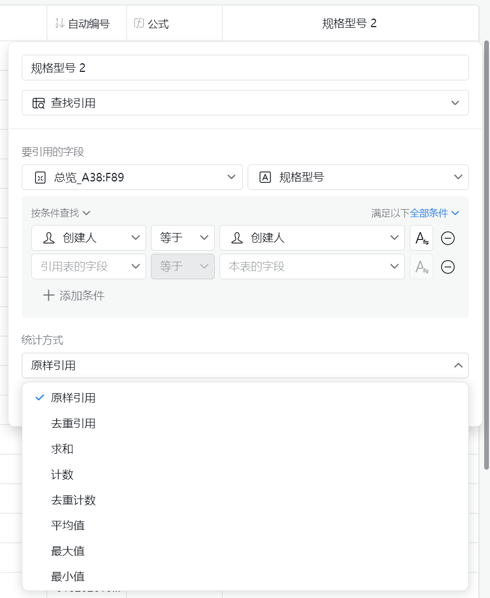
- 单元格不可直接编辑（BlockedEditor：「查找引用内容不可直接编辑」）。

### 8.3 与现有 dyn_engine 的关系

- relation 值建议存 JSON 列（`JSON_ARRAY` of recordId），dyn_engine 查询时 join 目标 dyn_ 表取主列值；
- lookup 的求值放在后端 `LookupService`：条件编译为对源表的 SQL 查询 → 聚合 → 写回缓存值；源表变更通过变更事件总线触发失效重算（与自动化引擎共用事件）。

---

## 9. 公式引擎

### 9.1 公式编辑器（全屏）

- **表达式编辑区**：字段以 **chip 胶囊**形式插入（带类型图标，如 `A 产品编号`、`⊙ 产品名称`）——防手误且携带类型信息；支持运算符 `+ - * /`、比较、逻辑与或；
- **即输即验**：静态类型检查 + **用第 1 行真实数据试算**，错误定位到行号与参数位置，输出人话诊断：
  > `第 1 行 = 类型转换错误` —— `"+"函数中的第1个参数需要数字值，但"P001"无法强制转换为数字。`
- **函数面板**（左下）：分类浏览（文本函数/数字/日期/逻辑/统计…），Tab 键补全；
- **函数文档面板**（右下）：签名 + 中文描述 + 示例（`TEXT(数值,格式)` → `TEXT("2024-09-14","ddd") = 周六`）；
- 右上「格式优化」（自动美化缩进换行）、帮助、保存；

**参考截图：**


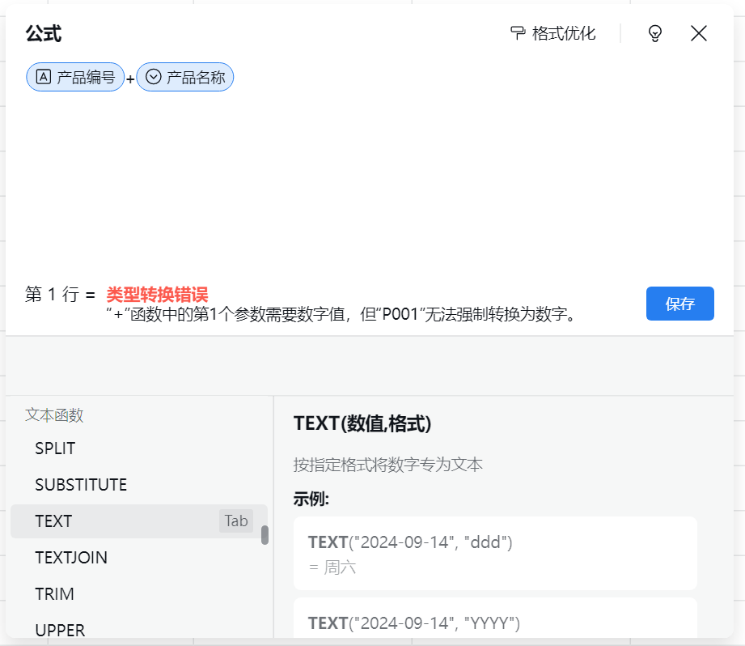
- **AI 生成公式**：自然语言描述 → LLM 生成表达式 → 用户确认写入。

### 9.2 函数体系（一期最小集）

| 分类 | 函数 |
|---|---|
| 文本 | CONCAT / TEXTJOIN / SPLIT / SUBSTITUTE / TEXT / TRIM / UPPER / LOWER / LEFT / RIGHT / MID / LEN |
| 数字 | ROUND / ABS / SUM / AVERAGE / MAX / MIN / COUNT / COUNTA |
| 日期 | TODAY / NOW / YEAR / MONTH / DAY / DATEDIF / DATEADD / WORKDAY |
| 逻辑 | IF / IFS / AND / OR / NOT / ISBLANK / IFERROR |
| 统计/聚合 | （配合分组汇总行，公式内一期不做跨行聚合） |

### 9.3 计算引擎

- **依赖图**：保存公式时解析 `referencedFieldIds`，构建有向图；**循环引用检测**（保存时拒绝）；
- **计算时机**：保存公式后全表计算；之后任一被引用字段变更时按拓扑序**增量重算**（含 lookup 链：字段变更 → 公式重算 → 依赖该公式的公式再重算）；
- **结果缓存**：计算值落库（查询/筛选/排序直接用缓存列），记录级 `computedMeta: {status: ok|pending|error, error, lastCalcAt}`；
- **执行位置**：一期后端 Python 实现求值器（与筛选 DSL 共用表达式基础设施）；前端编辑器内嵌同款 JS 求值器用于实时试算（两端语义须一致，建议定义一份**函数语义规范表**双端实现）；
- 公式结果有类型（returnType），渲染器按类型分发（数字结果也支持千位符等格式配置）；
- 自动重算**不触发**「最后编辑人/时间」更新（§3.3 系统字段纪律）。

---

## 10. AI 字段

### 10.1 场景市场（AI 字段配置界面）

三栏联动：左侧场景详情卡 ｜ 右侧场景市场（搜索 + 分类 Tab：推荐/项目管理/客户管理/信息提取…，双列网格，键盘 ↑↓/↵ 导航）｜ 底部「自定义 AI 字段」入口。

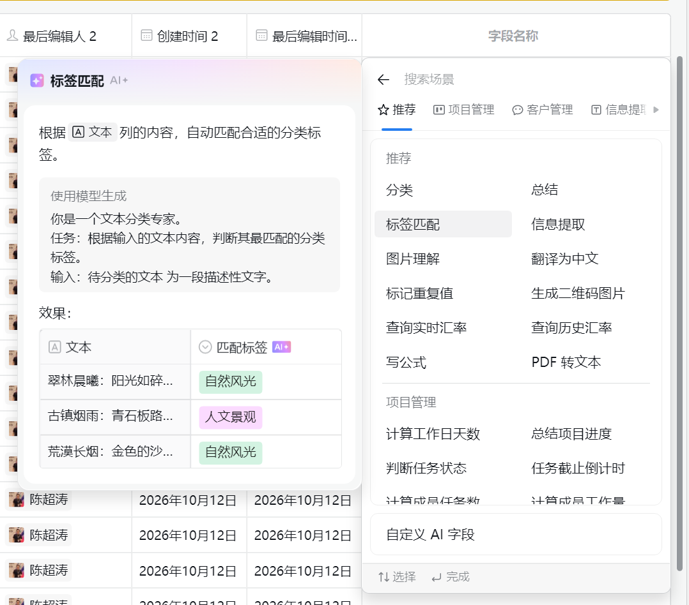

一期实现场景（按价值排序）：

| 场景 | 输入 → 输出 | 说明 |
|---|---|---|
| 标签匹配 | 文本列 → 单选/多选标签 | 自动分类，可自动建选项 |
| 分类 | 文本列 → 单选 | 同上语义略异 |
| 总结 | 多列 → 文本 | 行内容摘要（如「单价总结」：基于整列统计——中位数/均值/标准差——生成自然语言分析） |
| 信息提取 | 文本/文件列 → 结构化字段 | 名片识别等 |
| PDF 转文本 | 文件列 → 文本 | 独立场景（与信息提取并列） |
| 翻译为中文 | 文本 → 文本 | |
| 写公式 | 自然语言 → 公式表达式 | 与公式编辑器打通 |
| 标记重复值 | 列 → 复选框 | |
| 图片理解 | 图片列 → 文本 | 多模态（对接现有 vision 模块） |
| 自定义 AI 字段 | 自定义提示词 + 字段变量 | 逃生舱，低代码「AI 列函数」 |

项目管理分类（二期候选）：计算工作日天数、总结项目进度、判断任务状态、任务截止倒计时、计算成员任务数、计算成员工作量。

二期（需工具调用能力）：查询实时/历史汇率、生成二维码图片等。

### 10.2 运行机制

- **场景 = 提示词模板 + 输入字段映射 + 输出类型 + 工具集**；场景详情卡展示说明（内嵌可替换的字段 chip）、提示词预览、「效果预览」示例表格；
- **触发**：新增行自动计算 / 输入字段变更自动重算 / 手动批量刷新（`trigger` 配置）；
- **异步执行**：AI 计算为异步任务队列（单元格状态：生成中/完成/失败，前端轮询或 WebSocket 推送）；结果缓存落库；
- **留痕**：AI 写入的记录，「最后编辑人」显示「AI 生成」——审计字段需支持**非人主体**（sysMeta.actor = {type: 'user'|'ai'|'automation', id}）；
- **配额计费**：AI+ 角标 = 增值功能，纳入套餐配额（对接 plan_entitlements，按次/按 token 计量）。

---

## 11. 自动化提醒引擎

### 11.1 模型：触发器 + 条件 + 动作链

```ts
interface AutomationRule {
  id: string; tableId: string; name: string;       // 名称可编辑，如「定时提醒」
  enabled: boolean;
  trigger: {
    type: 'schedule' | 'recordCreated' | 'recordUpdated' | 'dateReached';
    tableId: string,                     // 事件型触发器自带表下拉（「在 [表 ▾] 里…」）；
                                         // 规则级 tableId 即触发器表，动作可跨表另选
    schedule?: { freq: 'daily'|'weekly'|'monthly', time: '19:30', weekdays?: number[] };
    watchFields?: string[] | 'all';      // recordUpdated：「指定列」有变更时
    rowConditions?: Condition[];         // 前置条件：如「产品编号 不为空」
    filters?: Condition[];               // 过滤器：且被添加/变更的记录满足条件
                                         // （文案随触发器类型适配；AND，可切 所有|任一）
  };
  actions: Action[];                       // 有序、可增删，按步骤编号执行
}
type Action =
  | { type: 'sendMessage', channel: 'docMessage'|'groupMessage'|'sms'|'email',
      to: userId[], content: RichText,      // 富文本 + 变量胶囊
      buttons?: [{ label: '查看记录', action: 'openRecord' }] }
  | { type: 'findRecords', tableId, scope: 'matching', onNotFound: 'continue'|'abort' }
  | { type: 'createRecord', tableId, values: Record<fieldId, ValueOrVariable> }
  | { type: 'updateRecords', tableId, target: 'all'|'triggered'|'found', set: {...} }
```

### 11.2 关键语义（截图实测）

- **事件型触发在事件发生时点对整行求值**：「添加新记录时 + 产品编号不为空」——插空白行不触发；UI 明确提示「如需在添加空白行后再修改时触发，可设置"记录内容变更"触发条件」；
- **条件不满足时整链不执行**（提示条：「条件未满足时，任何编辑均不会触发后续操作」）；
- **变量系统**：动作间变量引用格式为「**第 N 步 + 动作名 + 的 + 变量名**」（如胶囊「第1步修改记录的 操作人 / 操作时间」）；变量菜单四类：仪表盘ⓘ（悬停提示「插入的仪表盘将以图片形式展示」）、分析报告ⓘ、自然时间（「今天」）、第 N 步的；编辑器中变量为富文本内的原子胶囊节点，可单独删除；消息内容支持 emoji（编辑器带「添加表情」按钮）；
- **发送方式**：文档消息（通过文档动态）/ 群消息（通过应用发送到群）——本项目映射为站内通知 + Webhook/短信（复用现有 NotifySvc）；
- **防循环触发**：动作「修改记录」可能再次命中「记录变更」触发器——递归深度限制（如 3）+ 触发来源标记（automation 来源的变更默认可配置是否再触发）；
- **批量动作**（对「所有记录」修改）：异步任务 + 进度反馈 + 可中止；
- **运行日志**：每次执行持久化（触发快照、各步结果、错误信息），面板顶部「☰ 运行日志」入口。

### 11.3 两个入口层级

1. **列级精简版**（表头菜单「内容变更时提醒」）：监听字段**默认当前列、可下拉改选**，只选字段/渠道/接收人，「更多配置 ›」进入完整版；
2. **完整版**（右上工具栏时钟图标 → 抽屉式编辑器）：完整触发器 + 条件 + 多步动作链，顶部步骤时间线（第1步/第2步/第3步…）；触发器与每步动作类型均为下拉可切换（「记录内容变更时 ▾」「发送消息 ▾」「查找记录 ▾」「修改记录 ▾」…）。

**参考截图：**


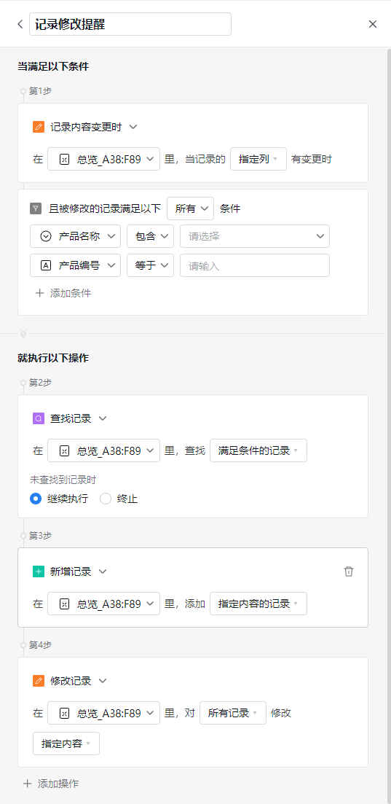


### 11.4 与现有任务引擎的整合

现有 APScheduler 任务引擎（条件规则 → 提醒）演进为：

```
┌─ 调度器（APScheduler）：schedule 触发器 cron 化
├─ 变更事件总线：dyn_engine 写路径发出 recordCreated/recordUpdated 事件
│   （自动化引擎与 lookup 失效重算共用）
├─ 条件求值器：复用筛选 DSL 求值（§5.1）
└─ 动作执行器：sendMessage→NotifySvc / createRecord,updateRecords→dyn_engine
```

---

## 12. 表单生成与数据回流

### 12.1 表单 = 一种视图

表单与表格视图并列于 Tab 页签（[表格视图] [表单] [+]）。**一个表格可创建多个表单视图**（如实测 [表单] [表单 2] 并存），题目配置与分享链接各自独立。入口：Tab 的「+」或右上工具栏的表单图标（☑）。「生成表单」把表格字段全量映射为表单题目：

- 左侧面板「可添加字段」（未入表单的字段）+「全部移出」+「⊕ 添加新字段到表单」（**同步建表列**——双向绑定）；
- 中央画布：添加封面 / 表单标题 / 添加描述 / 题目卡片列表 / 底部「⊕ 添加新字段」（第二入口）；
- 表单编辑态顶部工具条：撤销 ↶ / 重做 ↷ /「⏱ 设置自动化提醒」（直达自动化，§11）；
- 顶部「编辑表单 | 填写表单」切换编辑态与预览填写态；
- 从「新建 → 收集表单」直接创建时：生成**表单 + 隐藏结果表**组合，默认 3 题（文本题/单选题/图片题），Tab 为「收集表单｜表单收集结果」（§2.5）。

**参考截图：**

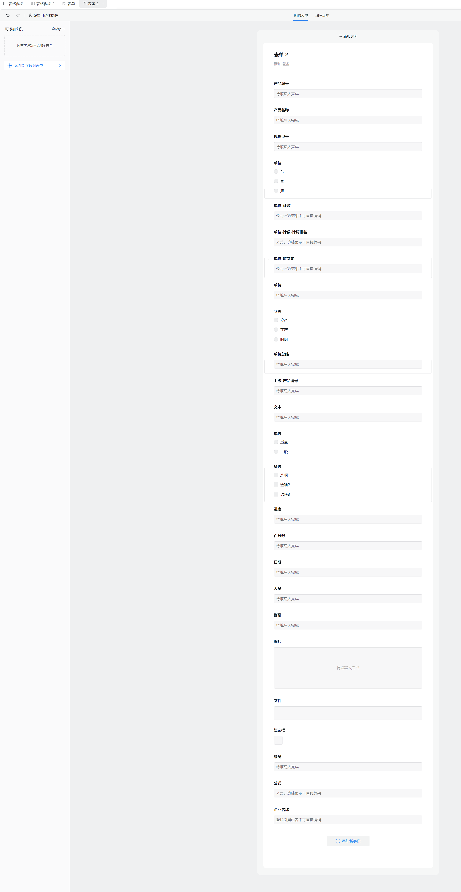


### 12.2 题目配置（选中题目卡片展开）

```
[题目名（默认=字段名，可覆盖）] [添加问题描述]
[选项列表：拖拽排序 + 色块 + ⊖ 删除 + ＋添加选项]   ← 与字段选项同一数据源
底部属性条：字段[✓ 绑定列 ▾] ｜ 控件形态[下拉 ▾] ｜ ☐必填 ｜ ☷显示条件 ｜ ⊖移出 ｜ ⋯更多
```

```ts
interface FormItem {
  fieldId: string;
  titleOverride?: string;
  description?: string;
  widget?: 'dropdown' | 'inline';    // 单选：下拉 vs 平铺 radio
  required: boolean;
  visibilityRule?: Condition[];      // 显示条件：基于其他题目值的显隐规则
  order: number;
}
```

- 计算类字段（公式/查找引用）在表单中**只读置灰**，占位文案「公式计算结果不可直接编辑」「查找引用内容不可直接编辑」，不采集输入；
- 选项编辑直接改字段级选项（与表格共享数据源），需提示「此处修改将影响表格列」。

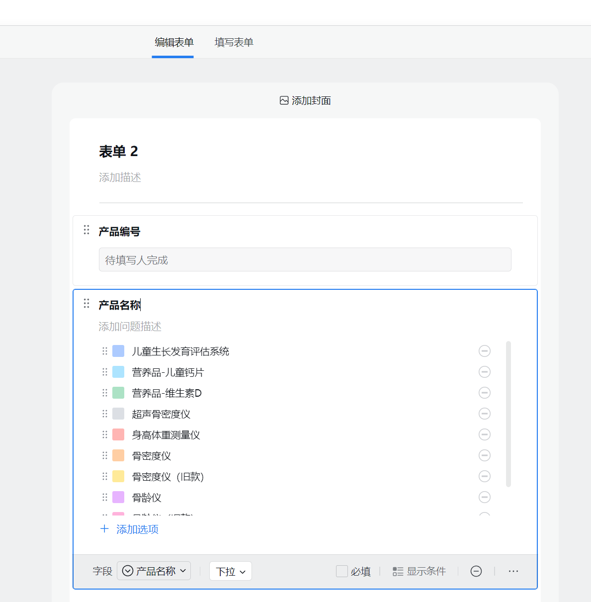

### 12.3 提交回流

填写表单提交 → **走与表格新增记录完全相同的写入管线**（dyn_engine.insert）：
- 自动触发「添加新记录时」自动化规则（§11）；
- 系统字段正常写入（创建人 = 登录用户或「匿名外部填写者」，见权限文档的匿名填写者判定）；
- 「可首次提交」权限语义在此生效（§13）：首次可写、之后只读；
- 字段级校验（必填/格式）在服务端复核。

表单对外分享复用现有 `share_links` 模块（匿名链接 + 可选密码/有效期）。

---

## 13. 权限体系

### 13.1 四层模型

```
L0 文档级权限（现有分享体系）：可编辑 / 仅浏览 —— 大门
    └─ 「仅浏览成员编辑前仍需申请文档编辑权限」
L1 内容权限·表级等级：无权限 < 仅浏览 < 可编辑 < 全部权限（每个子表/页面一档）
L2 行级（记录权限）：范围(全部 | 部分+条件) × 动作(查看/编辑/添加/删除/视图管理)
L3 列级（字段权限）：每字段三态 可查看 / 可首次提交 / 可编辑
                    （全部权限等级另含「修改字段设置」= schema 级）
```

等级即预设模板：无权限（全空，右侧配置区为空仅剩等级下拉）/ 仅浏览（行 view + 列 view）/ 可编辑（行 CRUD 范围 + 列三态 + 视图管理）/ 全部权限（全开 + schema 修改；该档下行/列权限以摘要语 + 蓝色「更改」链接呈现——「可以编辑、新增、删除所有记录。更改」，点「更改」可展开为细粒度配置）。


### 13.2 权限主体：全员基线 + 指定成员组（grant-only 叠加）

| 层 | 主体 | 作用 |
|---|---|---|
| 全员权限 | 文档内所有成员 | 每张表的基线 |
| 指定成员额外权限 | 命名成员组（成员集合 + 角色备注名，如「负责人」「经理」——内置分类角色词典） | 在基线之上**追加**，不可削减 |

**合并规则**：`effective = max(全员, ∪所属各组额外权限)`——行范围取并集、布尔能力取或、字段三态逐位取或。全员已更高时**编辑过程中实时三层预警**：① 顶部黄条「因全员权限高于 X 权限，额外权限未生效」+「查看全员权限」链接；② 摘要卡片（「全员权限为"可编辑"，X 还有下方额外权限」）含「恢复至全员权限」一键清理；③ 「记录权限（行）」分节内联黄色小字。保存时服务端复核。

**指定成员组的两步创建流**：第 1 步「指定成员设置」对话框 = 选择成员（列表 + 全选 + ⊖ 移除 +「添加指定成员」）+ 备注名（**可自由填写或从内置词典选择**，词典分类：通用/产品研发/常见岗位/项目分工/客户服务/订单采购，词条如负责人/提出人/经理/员工/组长/内部/其他团队）+「继续添加权限」；第 2 步进入与全员权限**同构**的组权限对话框（标题 = 备注名，副标题「对指定成员生效 ›」，左列各条目显示该组当前状态如「无额外权限」）。注意：**备注名对被授权成员可见**（「指定成员也能看到这个名称」），命名需规范。


### 13.3 行级条件引擎

- 条件三元组 `{fieldId, op, value}`，op 随字段类型变化；值支持静态值与**上下文变量 `$viewer`（查看者本人）**——实现「我的记录只能自己改」；
- 双用途：查看范围（仅浏览/编辑降级）与编辑范围共用同一引擎（复用筛选 DSL 求值器）；
- **UI 规则**：「可以查看的记录范围」配置仅在仅浏览（VIEW）等级出现；可编辑（EDIT）等级查看范围恒为全部，只暴露「可以编辑的记录范围」+ fallback；编辑范围选项直接显示记录总数（「全部 56 条记录」）；
- 降级链：命中条件 → 可编辑 → 未命中 → fallback（默认「只可查看」，**以下拉切换**——「满足此条件时可编辑，否则只可查看 ▾」，另一选项疑似「不可查看」，待确认见附录 C）；


- 一期多条件 AND 语义。

### 13.4 字段级约束矩阵（截图实测）

| 字段类别 | 可编辑 | 可首次提交 | 可查看 |
|---|---|---|---|
| 普通业务字段 | 可配 | 可配 | 可配 |
| 公式 / 自动编号 / 查找引用 | 禁（灰） | 禁（灰） | 可配 |
| 系统字段（创建人/时间、编辑人/时间） | 禁（灰） | 禁（灰） | **强制可见**（灰勾锁定） |
| **主列（首列）** | 可配 | 可配 | **强制可见**（灰勾锁定，与系统字段同待遇） |
| 后续新增字段 | 有默认策略行，三态可预设 | 同左 | 同左 |

字段权限区 UI 细节：顶部「可编辑所有内容 / 按字段设置」单选（对应 `fields.mode`）；「已有字段」行为**主控复选框**（整列批量切换三态）；字段列表**按列编组分组渲染**（编组头下挂成员字段）；实测 AI 字段、关联字段三态均可配。


「可首次提交」= 仅记录创建（表单首次提交）时可写，之后只读——「填了不许改」场景。联动校验：`可查看=false` 时可编辑/可首次提交强制禁用。

### 13.5 数据结构

```ts
interface SheetPermission {
  tableId: string;
  base: PermissionProfile;                          // 全员基线
  groupGrants: [{ groupId, profile: PermissionProfile }];
}
interface PermissionProfile {
  level: 'NONE'|'VIEW'|'EDIT'|'FULL';
  viewManage?: boolean;
  record: {
    viewScope: 'ALL'|'PARTIAL'; viewConditions?: Condition[];
    editScope?: 'ALL'|'PARTIAL'; editConditions?: Condition[];
    editFallback?: 'VIEW_ONLY'|'NO_ACCESS';
    add?: boolean; delete?: boolean;
  };
  fields: {
    mode: 'ALL'|'PER_FIELD';
    newFieldDefault: { view, firstSubmit, edit };
    items: Record<fieldId, { view, firstSubmit, edit }>;
  };
  schemaEdit?: boolean;                              // FULL 专有
}
interface PermissionGroup { id; name; memberIds: string[] }   // 备注名如「负责人」
```

### 13.6 校验流程

1. **入口**：鉴权（L0 文档成员身份 + 文档级可编辑/仅浏览）；
2. **解析**：加载 base + 用户所属全部组的 grants → max 合并为 effectiveProfile（缓存，组/配置变更时失效）；
3. **读路径**：行过滤条件**下推至查询层**（dyn_engine 编译为 SQL WHERE）；列投影按 `fields.view` 裁剪——接口层面不返回无权数据，而非前端隐藏；`NONE` 直接在列表接口剔除；
4. **写路径**：等级门槛 → 动作检查（add/delete/viewManage）→ 行条件单行复核（防并发漂移）→ 字段白名单（编辑用 `edit`，新建用 `firstSubmit ∪ edit`）→ 字段类型硬性规则（公式/系统字段拒绝）→ schema 修改需 FULL；
5. **审计**：权限变更记录审计日志（组、表、等级、条件快照）。

### 13.7 权限总览面板

入口：文档右上工具栏「🔒 内容权限」按钮（与「自动化」并列）。「内容权限」侧边栏：标题 +「了解功能用法和使用场景 ›」帮助链接；全员权限区（每条目：图标 + 名称 + 等级摘要 ›）+ 分隔文案「以下指定成员还拥有额外的内容权限。」+ 组卡片（备注名 + ⋯ 菜单 +「包含 陈超涛、郑小文」+ 组内各表等级行）；底部「＋ 为指定成员添加额外权限」。摘要语汇：`无权限 / 仅浏览 / 可编辑部分内容 / 全部权限`，由服务端合成（行或列被裁剪即为「部分内容」）。


### 13.8 与现有权限体系的对接

- L0 复用现有 shares/share_links；tenant 边界仍是第一行判定（先于一切）；
- 成员组 PermissionGroup 可复用/并入现有「用户组」概念；
- 仪表盘/报告类条目仅支持 全部/仅浏览 两档（无行列细配）；
- 功能预留「限时免费 → 付费分层」开关位（对接 plan_entitlements）。

---

## 14. 数据模型设计

> 原则：**复用 meta_* 元数据 + dyn_* 物理表架构**（每数据集一物理表的决策见 `docs/数据表设计.md`，单库 <5000 表内维持现状）。智慧表格新增的配置类数据全部走新元数据表；记录里的复杂类型值（数组/对象）存 dyn_ 表内的 JSON 列。

### 14.1 现有表扩展

```sql
-- meta_fields 扩展（在现有基础上加列）
ALTER TABLE meta_fields
  ADD COLUMN field_type VARCHAR(32) NOT NULL DEFAULT 'text',   -- 22+1 种类型标识
  ADD COLUMN config JSON NULL,          -- §3.3 各类型 config
  ADD COLUMN group_id BIGINT NULL,      -- 所属列编组
  ADD COLUMN is_system TINYINT(1) DEFAULT 0,   -- 系统字段
  ADD COLUMN readonly TINYINT(1) DEFAULT 0;
```

### 14.2 新增元数据表

```sql
-- 文档与条目
CREATE TABLE smart_docs (
  id BIGINT PRIMARY KEY AUTO_INCREMENT,
  tenant_id BIGINT NOT NULL, name VARCHAR(200) NOT NULL,
  owner_id BIGINT NOT NULL, created_at DATETIME, updated_at DATETIME,
  KEY idx_tenant (tenant_id)
);
CREATE TABLE smart_doc_entries (
  id BIGINT PRIMARY KEY AUTO_INCREMENT,
  doc_id BIGINT NOT NULL, parent_id BIGINT NULL,
  type VARCHAR(16) NOT NULL,             -- sheet|dashboard|form|report|folder
  name VARCHAR(200) NOT NULL, ref_table_id BIGINT NULL,  -- sheet 关联 meta_tables.id
  ai_flag TINYINT(1) DEFAULT 0, order_no INT DEFAULT 0,
  KEY idx_doc (doc_id)
);

-- 视图
CREATE TABLE meta_views (
  id BIGINT PRIMARY KEY AUTO_INCREMENT,
  table_id BIGINT NOT NULL,
  name VARCHAR(100), type VARCHAR(16) DEFAULT 'grid',  -- grid|form|kanban
  config JSON NOT NULL,      -- {filter, groups, sorts, fillRules, rowHeight,
                             --  fieldVisibility, fieldOrder, frozenFieldId,
                             --  aggregations, columnStyles}
  is_default TINYINT(1) DEFAULT 0,
  created_by BIGINT, created_at DATETIME,
  KEY idx_table (table_id)
);

-- 视图的个人覆盖（「调整仅你可见」）
CREATE TABLE meta_view_prefs (
  id BIGINT PRIMARY KEY AUTO_INCREMENT,
  view_id BIGINT NOT NULL, user_id BIGINT NOT NULL,
  config JSON NOT NULL,                  -- 结构同 views.config 的增量
  UNIQUE KEY uk_view_user (view_id, user_id)
);

-- 列编组
CREATE TABLE meta_column_groups (
  id BIGINT PRIMARY KEY AUTO_INCREMENT,
  table_id BIGINT NOT NULL, name VARCHAR(100), order_no INT
);

-- 自动编号计数器（原子自增）
CREATE TABLE meta_sequences (
  id BIGINT PRIMARY KEY AUTO_INCREMENT,
  table_id BIGINT NOT NULL, field_id BIGINT NOT NULL,
  current_value BIGINT NOT NULL DEFAULT 0,
  UNIQUE KEY uk_field (field_id)
);

-- 自动化规则
CREATE TABLE meta_automations (
  id BIGINT PRIMARY KEY AUTO_INCREMENT,
  table_id BIGINT NOT NULL, name VARCHAR(200),
  enabled TINYINT(1) DEFAULT 1,
  trigger_config JSON NOT NULL, actions JSON NOT NULL,
  created_by BIGINT, created_at DATETIME, updated_at DATETIME,
  KEY idx_table (table_id)
);
CREATE TABLE automation_run_logs (
  id BIGINT PRIMARY KEY AUTO_INCREMENT,
  rule_id BIGINT NOT NULL,
  trigger_snapshot JSON,           -- 触发时的记录/时间快照
  status VARCHAR(16),              -- success|partial|failed|skipped
  step_results JSON, error TEXT,
  started_at DATETIME, finished_at DATETIME,
  KEY idx_rule (rule_id, started_at)
);

-- 表单
CREATE TABLE meta_forms (
  id BIGINT PRIMARY KEY AUTO_INCREMENT,
  view_id BIGINT NOT NULL,           -- 表单即视图
  title VARCHAR(200), description TEXT, cover_file_id BIGINT NULL,
  items JSON NOT NULL,               -- FormItem[]
  submit_config JSON,                -- 提交后提示、允许重复提交、匿名设置
  KEY idx_view (view_id)
);

-- 内容权限
CREATE TABLE sheet_permissions (
  id BIGINT PRIMARY KEY AUTO_INCREMENT,
  table_id BIGINT NOT NULL,
  base_profile JSON NOT NULL,        -- PermissionProfile（全员基线）
  UNIQUE KEY uk_table (table_id)
);
CREATE TABLE permission_groups (
  id BIGINT PRIMARY KEY AUTO_INCREMENT,
  doc_id BIGINT NOT NULL, name VARCHAR(50),     -- 「负责人」等备注名
  member_ids JSON NOT NULL
);
CREATE TABLE sheet_group_grants (
  id BIGINT PRIMARY KEY AUTO_INCREMENT,
  group_id BIGINT NOT NULL, table_id BIGINT NOT NULL,
  profile JSON NOT NULL,             -- PermissionProfile（额外权限）
  UNIQUE KEY uk_group_table (group_id, table_id)
);

-- AI 字段运行状态（可选，热数据也可存记录 JSON）
CREATE TABLE ai_field_runs (
  id BIGINT PRIMARY KEY AUTO_INCREMENT,
  table_id BIGINT, field_id BIGINT, record_id BIGINT,
  status VARCHAR(16),                -- pending|running|ok|error
  tokens_used INT, error TEXT, ran_at DATETIME,
  KEY idx_field_record (field_id, record_id)
);

-- 仪表盘图表（§2.5.1）
CREATE TABLE dashboard_widgets (
  id BIGINT PRIMARY KEY AUTO_INCREMENT,
  entry_id BIGINT NOT NULL,          -- smart_doc_entries.id（dashboard）
  chart_type VARCHAR(16),            -- bar|line|pie|barH|combo|table|wordcloud|metric|text
  sub_type VARCHAR(32), theme VARCHAR(32),
  source_table_id BIGINT, source_filter JSON,
  dimensions JSON, metrics JSON, sort JSON, extra JSON,
  layout JSON,                       -- 画布位置尺寸
  KEY idx_entry (entry_id)
);

-- 导入任务（§2.5.4）
CREATE TABLE import_tasks (
  id BIGINT PRIMARY KEY AUTO_INCREMENT,
  tenant_id BIGINT, user_id BIGINT,
  source_type VARCHAR(16),           -- local|online|chat
  file_key VARCHAR(200), doc_id VARCHAR(100),
  status VARCHAR(16),                -- pending|parsing|done|failed
  result_table_id BIGINT, error TEXT,
  created_at DATETIME, finished_at DATETIME
);

-- 模板库（§2.5.3）
CREATE TABLE templates (
  id BIGINT PRIMARY KEY AUTO_INCREMENT,
  category VARCHAR(50), name VARCHAR(100), description VARCHAR(500),
  cover_snapshot VARCHAR(200),
  schema_snapshot JSON,              -- 字段+视图+仪表盘+自动化完整快照
  ai_features JSON, is_builtin TINYINT(1),
  owner_id BIGINT                    -- 我的模板（用户自建）非空
);
```

### 14.3 记录存储（dyn_ 物理表内）

```sql
-- 每条 dyn_ 业务表追加系统列（建表时由 dyn_engine 统一加）
parent_id      BIGINT NULL,      -- 树形层级（自关联，可建索引）
created_by     BIGINT, created_at     DATETIME,
updated_by     BIGINT, updated_at     DATETIME,
updated_by_type VARCHAR(16) DEFAULT 'user'   -- user|ai|automation（AI 留痕）
```

字段值到列类型的映射（dyn_engine 建列规则）：

| 字段类型 | 列类型 |
|---|---|
| text/url/phone/email/barcode | VARCHAR(500) / 链接 JSON |
| number/percent/currency/progress | DECIMAL(18,4) |
| checkbox | TINYINT(1) |
| date/createdTime/lastModifiedTime | DATETIME（UTC） |
| singleSelect | VARCHAR(64)（optionId） |
| multiSelect/member/groupChat/relation | JSON 数组 |
| image/file | JSON（附件对象数组） |
| autoNumber | VARCHAR(64) + UNIQUE |
| formula/lookup/ai | 缓存列（类型随 returnType）+ 计算状态不入表 |

高频筛选/排序的 JSON 字段可按需加**生成列 + 索引**（见 `docs/数据表设计.md` 的性能结论）。

---

## 15. 前端架构设计

### 15.1 技术选型与组件树

在现有 Vue 3 + Vite + Element Plus + Pinia 栈上建设。网格层的选型结论：**没有现成组件能开箱实现整个智慧表格，但网格引擎可借力、其余必须自研**——分层看：

```
records → 权限裁剪 → 筛选DSL → 分组树 → 排序 → flatten → [异构行序列] → 渲染
                                                            │
        ┌───────────────────────────────────────────────────┘
        ▼
   GroupHeaderRow / DataRow / AddRow   ← 虚拟滚动网格只负责"高效渲染一串行"
        │
        ▼
   Cell → FieldTypeRegistry 分发 → CellRenderer / CellEditor（26 种类型）
```

flatten 之后网格看到的只是一串普通行（分组标题行、数据行、加行按钮行仅 `type` 不同），这正是通用表格组件的能力范围；而 26 种字段编辑器（人员双栏选择器、关联记录卡片、公式编辑器…）、RuleBuilder、条件胶囊、视图管线、AI 异步单元格是**产品差异化所在，任何组件库都不会有**，必须自研（约占工作量 70%）。

#### 网格组件选型对比

| 方案 | 能覆盖 | 缺什么 | 结论 |
|---|---|---|---|
| **vxe-table**（Vue3 原生） | 虚拟滚动、冻结列、列宽拖拽、树形行、合并表头（编组）、汇总行、单元格自定义 slot | 无内置分组横幅行、筛选/排序 UI 要自己画 | ✅ **推荐打底** |
| ag-grid Vue | 网格能力最全（分组/聚合/透视） | 行分组、范围选择等在**企业版**（收费）；中文生态弱；单元格内嵌 Vue 组件需适配层 | 能力够但性价比低 |
| luckysheet（项目已嵌入） | Excel 级画布、公式 | 是「电子表格」不是「记录表」：无字段类型/记录/视图概念；单元格内渲染人员头像/彩色标签/进度条很困难；文档停留在旧版 | ❌ 方向不符 |
| Univer | luckysheet 的现代继任 | 同上，且生态早期 | ❌ |
| 纯自研（DOM + 虚拟滚动） | 完全可控 | 冻结/列宽/滚动同步都自己写，多 2-3 周 | 兜底方案 |

**最终选型：vxe-table 打底 + 自研核心层**：

```
┌─ 借力层 ────────────────────────────────┐
│ vxe-table：虚拟滚动/冻结列/列宽/树形/汇总行 │
│ Element Plus：Popover/Select/DatePicker…  │
│ ECharts（已有）：仪表盘图表               │
├─ 自研层（核心资产）──────────────────────┤
│ 1. FieldTypeRegistry（前后端各一套）       │
│ 2. CellEditor 体系（6 种提交策略）         │
│ 3. 视图管线 store（filter→group→sort 链）  │
│ 4. RuleBuilder（筛选/排序/填色/权限条件复用）│
│ 5. 公式引擎 + 自动化引擎（后端为主）        │
└───────────────────────────────────────────┘
```

**两个关键风险点（提前验证）**：

1. **分组横幅行**：flattened 行序列里渲染跨列横幅，vxe-table 用行跨度合并（span-method）可实现，但与树形行、虚拟滚动叠加需验证——**第一周做 spike：分组 + 树形 + 冻结列三者同开**，不行则退回纯自研 DOM 网格；
2. **浮层层级管理**：人员浮层上再开通讯录 Modal、编辑态外点提交——在第一个复杂编辑器（单选）时就抽象好 Popover 基础设施，避免 26 个编辑器重复踩坑。

规模假设：单视图 <5000 行，DOM + 虚拟滚动足够，无需 Canvas 渲染。

```
SmartTablePage
├─ NavSidebar（文档条目树）
├─ ViewTabs
├─ Toolbar
│   ├─ AddRowButton / TableSettingsPanel
│   ├─ RulePopover × 4（Filter / Group / Sort / Fill —— 共用 RuleBuilder）
│   ├─ RowHeightMenu
│   └─ RightCommands（筛选胶囊区 | 表单 | 自动化 | 撤销重做 | 查找替换）
├─ SmartGrid（基于 vxe-table 深度封装的虚拟滚动网格）
│   ├─ GridHeader（两层：编组头 + 字段头；列宽拖拽/冻结/菜单）
│   ├─ VirtualRows（行序列 = flatten(groupTree)）
│   │   ├─ GroupHeaderRow（缩进/折叠/聚合值）
│   │   ├─ DataRow → Cell（CellRenderer 分发；编辑态挂载 CellEditor）
│   │   └─ AddRowButton（组内/底部）
│   └─ SummaryRow（聚合行）
├─ RecordDetailDrawer（展开记录）
├─ FieldConfigDialog（字段配置，按类型挂子表单）
├─ FormulaEditorModal（全屏公式编辑器）
├─ AiFieldDialog（场景市场）
├─ AutomationDrawer（自动化规则编辑器）
├─ FormEditor / FormRenderer（表单编辑态/填写态）
└─ PermissionPanel（内容权限）
```

### 15.2 状态管理（Pinia）

```
useTableStore      — 当前表：fields[]、records（分页/全量）、sysMeta
useViewStore       — 当前视图配置 + 派生计算（filteredRows → groupTree → flatRows，全链路 computed）
useSelectionStore  — 单元格焦点/编辑态/多选
usePermissionStore — effectiveProfile（决定每个 Cell 可不可编辑、每列可见性）
useUndoStore       — 命令栈
```

### 15.3 关键性能设计

1. **虚拟滚动**：固定行高（行高配置 = 全局统一值，天然适配）；行序列异构（GroupHeader/DataRow/AddRow）但高度可枚举；
2. **计算管线 memo**：`records → filter → group → sort` 每步 computed 缓存，单元格编辑只失效受影响节点；
3. **填色求值 memo**：`fillRules × 可视行` 求值，规则不变则缓存；
4. **编辑局部更新**：单元格提交 = 乐观更新 + PATCH，整行对象不可变替换（`row = {...row, values: {...row.values, [f]: v}}`），避免全表重渲染；
5. **公式/lookup/AI 异步值**：记录 `computedMeta` 驱动单元格 loading/error 态，WebSocket 或轮询推送更新。

### 15.4 键盘与可用性

- 方向键移动焦点、Enter 编辑、Esc 取消、Tab 下一格、Ctrl+C/V 复制粘贴（一期文本类）、Ctrl+Z/Y 撤销重做；
- 字段类型选择/AI 场景市场支持 ↑↓ + ↵ + Tab 纯键盘流。

---

## 16. 后端架构与 API 设计

### 16.1 模块划分（backend/app）

```
routers/smart_docs.py      — 文档/条目 CRUD、导航树
routers/smart_views.py     — 视图 CRUD、个人覆盖
routers/smart_fields.py    — 字段 CRUD（含类型转换、删除依赖检查）、编组
routers/smart_records.py   — 记录 CRUD、批量操作、树形、查找替换（复用 dyn_engine）
routers/smart_automation.py— 自动化规则 CRUD、运行日志、手动触发
routers/smart_forms.py     — 表单配置、公开提交
routers/smart_perms.py     — 内容权限（基线/组/合并预览）
routers/smart_dashboards.py— 仪表盘 widget CRUD、图表预览聚合
routers/smart_import.py    — 导入任务（三来源适配器）
routers/templates.py       — 模板库列表/搜索/实例化/另存为模板
services/field_registry.py — 字段类型服务端注册表（校验/默认值/存储映射）
services/filter_engine.py  — 筛选/权限条件 DSL → SQL 编译 + 单行求值
services/formula_engine.py — 公式解析/求值/依赖图/增量重算
services/lookup_service.py — 查询引用求值与失效
services/automation_engine.py — 触发器(事件+调度)/动作链/变量作用域
services/ai_field_service.py — AI 字段任务队列（接 LLMGateway）
services/perm_service.py   — 权限合并与下推
```

### 16.2 核心 API（REST，节选）

```
GET    /api/smart-docs/{id}/tree                     文档导航树
POST   /api/smart-docs/{id}/entries                  新建条目（工作表/表单/文件夹…）

GET    /api/tables/{tid}/views                       视图列表
POST   /api/tables/{tid}/views                       新建视图
PATCH  /api/views/{vid}                              更新视图配置（filter/sort/…）
PUT    /api/views/{vid}/prefs                        个人覆盖（仅你可见）

POST   /api/tables/{tid}/fields                      新增字段（type+config）
PATCH  /api/fields/{fid}                             修改字段（含类型转换）
DELETE /api/fields/{fid}?confirm=deps                删除（先 GET /fields/{fid}/deps 查依赖）
POST   /api/tables/{tid}/column-groups               编组 CRUD

GET    /api/tables/{tid}/records?viewId=&cursor=     查询（视图配置服务端应用：
                                                     权限裁剪→筛选→分组→排序→分页）
POST   /api/tables/{tid}/records                     新增（含子记录 parent_id、表单提交同此管线）
PATCH  /api/records/{rid}                            编辑（权限逐字段复核）
POST   /api/tables/{tid}/records:batch               批量修改/删除/复制
GET    /api/tables/{tid}/search-replace              查找替换

CRUD   /api/tables/{tid}/automations                 自动化规则
GET    /api/automations/{aid}/runs                   运行日志
POST   /api/automations/{aid}/run                    手动触发

GET    /api/tables/{tid}/permission                  权限（基线+组+合并预览）
PUT    /api/tables/{tid}/permission/base
PUT    /api/perm-groups/{gid}/grants/{tid}

POST   /api/fields/{fid}/ai:run                      AI 字段批量触发
POST   /api/ai/generate-formula                      AI 生成公式
```

### 16.3 记录查询的请求处理链

```
viewId 加载视图配置 + 用户个人覆盖合并
  → perm_service：effectiveProfile → 行条件下推 SQL WHERE + 列投影裁剪
  → filter_engine：筛选 DSL → SQL
  → 分组/排序：ORDER BY（分组键+排序键）；分组树与聚合在服务端组装（小表可前端做）
  → 返回 { rows, groupTree?, aggregations, total }
```

---

## 17. 与现有系统的融合与改造点

| 现有模块 | 改造内容 | 工作量 |
|---|---|---|
| MetaField / dyn_engine | 字段类型枚举扩到 22+1；config JSON；JSON 列值；系统列（parent_id/created_by/updated_by_type）；筛选 DSL 编译挂接 | 中 |
| 任务引擎（APScheduler） | 抽象出「触发器 + 动作链」模型，旧规则迁移为 automation（定时+条件→消息） | 中 |
| NotifySvc | 新增「文档消息」渠道（站内动态）；消息模板变量渲染 | 小 |
| 报表/仪表盘 | 暴露「按列生成图表」API（groupBy+agg），承接「数据可视化」入口 | 小 |
| LLMGateway / vision | AI 字段任务队列、AI 生成公式、AI 匹配标签、图片理解 | 中 |
| shares / share_links | 表单公开填写链接；文档级权限 L0 复用 | 小 |
| RBAC / tenant_members | 内容权限作为叠加层；PermissionGroup 并入用户组 | 中 |
| 审计（audit） | actor 支持非人主体（ai/automation）；权限变更审计 | 小 |
| 前端 dyn 列表/表单 | 整体升级为 SmartGrid + RecordDetailDrawer（动态表单渲染器可复用现有表单生成逻辑） | 大 |

**存储决策维持现状**：每数据集一物理表（dyn_*），不迁 JSON 单表。智慧表格的视图/权限/自动化等配置全部独立元数据表，业务记录仍在物理表——筛选/分组/排序可直接编译为高效 SQL。

---

## 18. 分期实施计划

### V1 — MVP（网格 + 字段 + 基础视图）约 4-6 周
- SmartGrid（虚拟滚动、冻结、行高、单元格编辑器框架）
- 12 种字段类型：文本/单选/多选/数字/百分数/货币/日期/复选框/链接/电话/邮箱/人员
- 字段配置弹窗 + 表格设置面板（显隐/排序/新增/删除+依赖检查）
- 筛选（含条件胶囊、仅你可见）/ 排序 / 填色 / 底部汇总
- 记录操作：添加行、右键菜单、展开记录详情、多选批量删除
- 多视图 Tab（grid 类型）
- 新建入口：工作表（默认字段模板 + 5 空行）、文件夹（重命名/移入/删除）、导入本地 Excel（复用现有 ExcelParser）
- 撤销/重做

### V2 — 数据组织能力 约 4 周
- 多级分组（组内新增、组聚合、折叠）+ 全局外观（分组色带）
- 进度条、图片、文件、自动编号（含自定义编号段）
- 关联 + 查找引用（双向关联、视图限定、聚合方式）
- 公式引擎（编辑器 + 一期函数集 + 依赖图增量重算）
- 子记录（树形层级）、列编组（多级表头）
- 查找替换、整列填色、创建副本
- 仪表盘（图表配置弹窗 + 通用聚合接口，复用报表引擎取数层）

### V3 — 协作与智能 约 5-6 周
- 内容权限（全员基线 + 指定成员组 + 行列级 + $viewer 条件）
- 表单生成与公开收集（题目配置、显示条件、提交回流；收集表单组合对象）
- 自动化引擎（定时/新增/变更触发 + 消息/增改记录动作链 + 运行日志 + 变量系统）
- AI 字段（标签匹配/总结/信息提取/PDF 转文本/自定义 + 配额）
- AI 生成公式、AI 匹配标签
- 数据可视化入口（生成图表/看板到仪表盘）

### V4 — 生态 约 3-4 周
- 模板库（分类/搜索/实例化/我的模板）
- AI 分析报告（快速/自定义生成 + 报告灵感模板）
- ~~导入在线表格 / 聊天文件、同步外部数据源~~

### 明确不做 / 缓做
- 实时协同编辑（OT/CRDT）—— 一期乐观锁 + 后写覆盖提示即可；
- ~~群聊字段（无企业微信环境）—— 降级为部门/用户组或暂缓；~~
- ~~地理位置、条码、地理位置、区域引用条目（_A38:F89）、同步外部数据源、仪表盘图片嵌入消息 —— 二期以后；~~
- 手机相册跨端上传 —— 移动端配套时再做。

---

## 19. 附录

### 附录 A：截图文件名与内容错位对照表

以下错位已逐张人工核验（2026-10-13 复核）。**全库仅 4 对文件错位**，其余均名实相符：

| 文件 | 实际内容 |
|---|---|
| 单元格输入/单元格输入-多选.png | 进度（内联滑块） |
| 单元格输入/单元格输入-进度.png | 多选（tag + 复选下拉） |
| 内容权限/内容权限-可编辑.png | 仅浏览等级配置 |
| 内容权限/内容权限-仅浏览.png | 可编辑等级配置 |
| 左下的新建/新建-收集表单.png | 文件夹/表单的右键菜单（重命名/移入文件夹/删除） |
| 左下的新建/新建-文件夹.png | 收集表单编辑界面 |

> 注：此前曾有几版分析对错位范围判断不一（表头工具栏、添加列、单元格输入的部分文件被误报错位），上表为逐张复核后的最终结论。建议按上表把这 6 个文件两两改名归档。

### 附录 B：截图目录索引

- `总览/` 整体布局；`添加列/` 26 种字段类型配置弹窗 + AI 字段；`单元格输入/` 各类型编辑器交互；
- `筛选/` `分组/` 视图配置面板与渲染效果；`排序.png` `行高.png` `填色.png` `表格设置.png` `添加一行.png` `表格全局样式.png`；
- `表头工具栏/` 列菜单全部功能；`右上侧工具栏/` 自动化/表单/查找替换；`单元格右键菜单/` 记录操作与编组；`内容权限/` 权限体系；
- `左下的新建/` 新建入口体系（工作表/仪表盘/收集表单/AI 报告/文件夹/导入/模板库）；
- `上方Tab页签.png` `左侧菜单.png` 导航与视图层。

### 附录 C：待产品决策的开放问题

1. 筛选多条件的且/或切换与嵌套条件组是否支持（截图未见 OR UI，一期 AND）；
2. 空值分组的排序位置、日期分组粒度（按日 or 年/月/周）；
3. 每组聚合方式是否可按列配置（默认数值列求和；最深层组头聚合值旁的 ▾ 疑似可就地切换）；
4. 关联字段的级联删除策略默认值；
5. 「指定视图」限定关联的 UI 细节（截图中未展开）；
6. 自动化「修改记录」动作是否默认再触发其他规则（防循环的默认策略）；
7. AI 字段的配额计量口径（按次 / 按 token）与套餐分档的映射；
8. 查找引用「统计方式」下拉在「最小值」下方仍有截断项，疑似第 9 项（如中位数/拼接），待补截图确认；
9. 行级编辑条件 fallback 下拉的另一选项是否为「不可查看」（截图未展开）；
10. 「同步数据」入口的配置细节（截图未展开）；
11. 仪表盘图表配置弹窗「更多配置」Tab 内容（截图未覆盖）。

